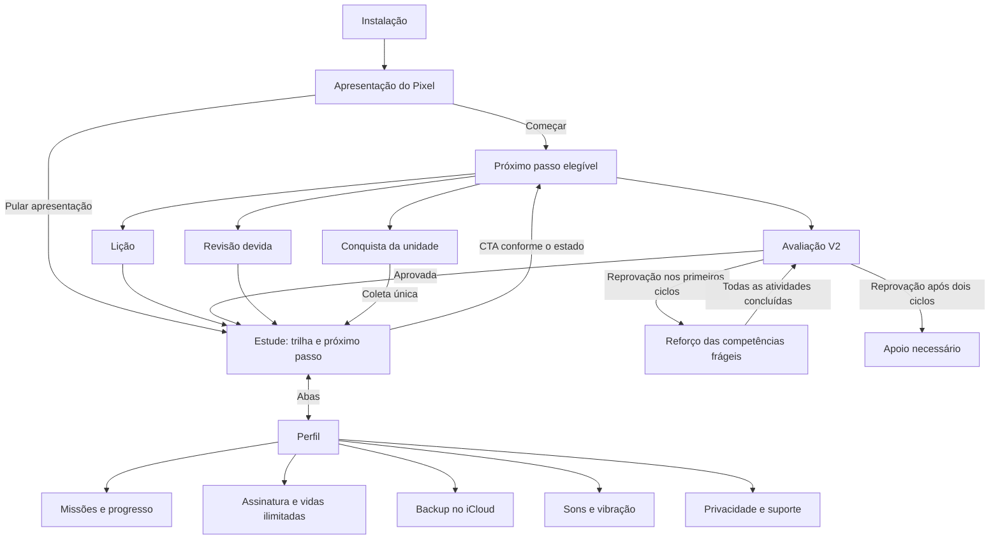
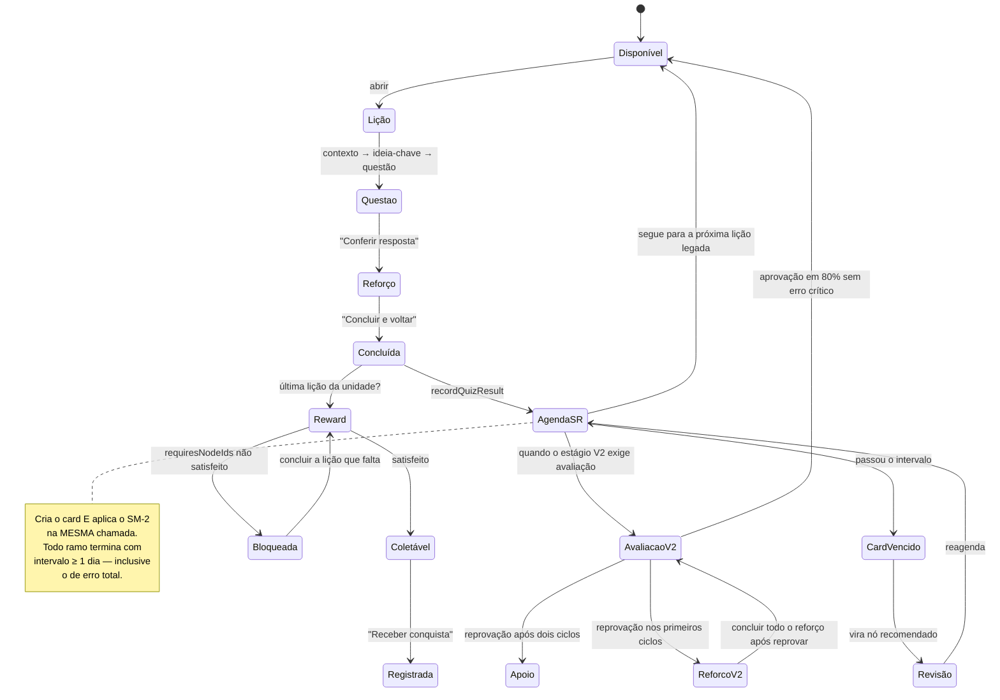

# Fluxo do cliente — o que o app faz com quem o usa

> **Atualizado em 2026-10-13:** descreve o código local até `8f5b4f2`,
> incluindo itens 36/39/27 e o primeiro pacote visual de estudo. Mudanças locais
> ainda sem publicação; lojas e gates ficam exclusivamente no [STATUS](STATUS.md).
> [Contrato visual](superpowers/specs/2026-10-12-study-experience-design.md) e
> [evidência](evidence/2026-10-12-study-experience-implementation.md).
> A [spec da 1.4](superpowers/specs/2026-09-14-radiant-1-4-fluxo-do-usuario-design.md)
> preserva vidas, StoreKit e iCloud; os itens 36/39/27 seguem sua
> [ADR](adr/ADR-2026-10-12-reforco-conquista-e-disponibilidade.md).

Escrito em 2026-08-06 a partir do **código**, não do roadmap. Cada afirmação
abaixo aponta para o arquivo que a sustenta, porque um diagrama sem procedência
envelhece sem avisar.

> **Este documento mora em `docs/` de propósito.** Ele descreve comportamento
> que muda com o código, então precisa mudar no mesmo commit — sob validador e
> sob revisão. O cérebro aponta para cá; a cópia não vive lá.

## Projeção no cérebro Obsidian

Em 2026-08-08, a pedido do dono, o caminho da pessoa ganhou uma projeção
renderizável no módulo opcional `10 Fluxo do usuário.md` do cérebro do Radiant.
A projeção de 2026-08-08 e o PDF imprimível não foram regenerados nesta
atualização e devem ser tratados como históricos. Ela serve como mapa de
navegação e raciocínio no Obsidian; **não substitui este
arquivo como fonte operacional**. O módulo declara essa precedência, aponta para
o PDF imprimível `docs/CLIENT_FLOW_PRINT.pdf` e só pode ser reprojetado pela CLI
pública do Loop — nunca por edição manual do vault.

São dois diagramas porque são duas perguntas diferentes. O primeiro responde
"por onde a pessoa anda"; o segundo, "o que decide se o próximo passo abre".
Misturar os dois é o que torna esse tipo de desenho ilegível.

## 1. O caminho da pessoa

Na primeira instalação, **Começar** persiste o encerramento da apresentação,
consulta o progresso e abre o próximo nó elegível — normalmente a primeira
lição. **Pular apresentação** persiste a mesma saída e abre a Home. Não existe
wizard de especialidade/meta nesse caminho, e rever a apresentação a partir do
app não dispara navegação automática no final.

A Estude coloca contexto/progresso e **uma recomendação** no header rolável da
trilha virtualizada. O card recebe o próximo nó do snapshot; a tela reutiliza
as rotas/eligibilidade existentes. A ação distingue `Retomar lição`, `Retomar
revisão`, `Retomar avaliação`, `Fazer revisão`, `Fazer avaliação`, `Receber
conquista` e `Continuar jornada`. Sem próximo nó elegível, há mensagem factual
sem botão inerte; revisão futura informa data real e não bloqueia outra lição.
([Tela](../radiant-app/src/features/journey/screens/JourneyHomeScreen.tsx),
[card](../radiant-app/src/features/journey/components/JourneyRecommendationCard.tsx)).

Na múltipla escolha do player, selecionar/trocar alternativa permanece separado
de **Conferir resposta**. Confirmar continua sendo responsabilidade do player;
cores e texto indicam seleção/feedback, sem nova cobrança ou transação.
A conclusão mostra Pixel/estrelas compactos e resultados factuais em linhas:
XP positivo/zero/null, total da unidade e revisão do resultado atual. Avaliar a
aula é opcional e separado da avaliação da loja. O retorno continua sendo
`Continuar` (hint “Volta para Estude”).

O código local prioriza lição pausada, revisão devida, avaliação, conquista
coletável e próxima lição, nessa ordem
([`NextNodeResolver.ts`](../radiant-app/src/features/journey/services/NextNodeResolver.ts)).
A conquista só entra depois dos pré-requisitos; coletá-la a retira da
recomendação. O E2E `reward-unlock` confirmou o CTA e a gravação em
2026-10-12 ([evidência](evidence/2026-10-12-itens-36-39-27.md)).

As abas atuais são **Estude e Perfil**. Missões, progresso, configuração de
sons, backup, assinatura e ajuda são acessados pelo Perfil. As rotas legadas
de mapa não são abas do fluxo principal.

O estudo, catálogo e progresso local funcionam **sem conta e sem API**.
Compra e backup dependem dos serviços da Apple. A evidência física de
2026-08-05 comprovou relaunch em modo avião com XP, sequência e catálogo
preservados naquela versão; não é um reteste físico do commit local atual.

## 2. O que decide se o próximo passo abre

Este diagrama descreve o agendador **legado**, que já governa a experiência
visível. O agendador novo por competência é tratado separadamente abaixo porque
seu lado de leitura ainda está desligado.

Três regras que o desenho existe para tornar visíveis:

1. **A revisão não é uma tela que se abre; é um nó que nasce quando o card
   vence.** `getDueLessons` filtra `nextReviewAt <= agora`
   ([`SpacedRepetitionService.ts`](../radiant-app/src/features/spaced-repetition/services/SpacedRepetitionService.ts)),
   e `recordQuizResult` cria o card **e** aplica o SM-2 na mesma chamada, com
   todo ramo terminando em intervalo ≥ 1 dia. Uma conclusão nova não cria
   revisão imediatamente devida; cartões anteriores podem estar vencidos.
   Ausência de revisão imediata após uma lição não é, por si só, defeito.
2. **A conquista tem duas portas.** O nó de reward abre com
   `requiresNodeIds: [node:<última lição>]`; antes disso a tela existe, mostra
   `Bloqueada até a unidade fechar` e **não oferece botão de coleta**. É por
   isso que a cobertura de E2E são dois flows sobre o mesmo nó —
   `reward-locked.yaml` prova a recusa, `reward-unlock.yaml` prova a regra.
3. **A avaliação V2 exige aprovação; a lição legada tem outra regra.** A
   avaliação requer 80% e nenhum erro crítico; nos estágios atuais de dois
   itens, isso exige os dois acertos. Na lição legada, errar ainda agenda
   revisão, mas vidas vazias pausam a lição pela folha de vidas. Revisões
   permanecem acessíveis sem vidas.

### As três melhorias locais do commit `a366295`

- **Reforço:** reprovar grava a tentativa e suas atividades pendentes no
  `AssessmentAttemptRepository`. Sair, voltar ou concluir só parte do reforço
  não libera a avaliação. `LessonOutcomeService.recordActivityCompletion`
  registra a conclusão real de cada atividade após a falha; ao completar o
  conjunto, a nova tentativa começa sem respostas antigas. Voltar da
  assinatura no meio dela preserva o progresso. O histórico mantém os dois
  ciclos e chega ao estado de apoio se as três tentativas forem reprovadas.
- **Conquista:** a Estude oferece `Receber conquista` para um nó liberado e
  não coletado. A recomendação não concede a recompensa; a coleta continua
  autorizada e idempotente pelo serviço da jornada.
- **Revisão futura:** o cartão recebe a agenda completa do SM-2 e mostra
  `Disponível em DD/MM/AAAA às HH:MM`, também no rótulo acessível, no fuso do
  aparelho. A informação não antecipa a fila devida nem libera pré-requisitos.

O reforço usa as atividades V2 já aprovadas, sem declarar novas modalidades
curriculares entregues. Seu histórico persiste no aparelho, mas ainda não
integra o backup no iCloud. Detalhes e provas na
[ADR](adr/ADR-2026-10-12-reforco-conquista-e-disponibilidade.md) e na
[evidência](evidence/2026-10-12-itens-36-39-27.md).

## 3. Kernel de retomada — implementado, produção em `off`

O kernel desenhado em 2026-08-09 já tem stores, adaptadores, diário de commit
idempotente e retomada implementados. Produção continua em `off`; o modo
`active` foi exercitado internamente, inclusive nos E2E do item 38 em
2026-10-12 ([estado medido](STATUS.md#item-38--manutenção-local-dos-e2e-2026-10-12)).
Esse kernel guarda retomada de tela; a exigência de reforço V2 acima usa um
repositório independente e funciona mesmo com o kernel desligado.

Checkpoint de tela não significa registrar cada toque. Ele guarda somente o
necessário para reconciliar uma retomada com a jornada atual: superfície, ids
estáveis, versão do conteúdo, cursor, progresso agregado e próxima ação. Em
`active` interno, apresentação, Lição, Revisão e avaliação têm retomada; as
demais superfícies usam a recomendação canônica da Estude.

O rollout permanece `off → shadow → active interno`. Em `shadow`, o cálculo não pode
alterar navegação, XP, domínio, desbloqueio ou sync. Duas falhas consecutivas de
restauração invalidam apenas o checkpoint e voltam à Home; progresso pedagógico
confirmado nunca é apagado. Contrato completo:
[`2026-08-09-checkpoints-e-loops-do-aluno-design.md`](superpowers/specs/2026-08-09-checkpoints-e-loops-do-aluno-design.md).

## O que estes diagramas NÃO dizem

- **Não detalham todo o ciclo StoreKit/iCloud.** A assinatura opcional oferece
  vidas ilimitadas; contratos e roteiro estão na spec da 1.4 e no STATUS.
- **Não descrevem sincronização remota ativa.** O perfil de produção desliga
  `ENABLE_REMOTE_SYNC` e não define URL da API. A flag sozinha não desliga o
  `AuthService`; esse limite está registrado no STATUS.
- **Não afirmam kernel ativo em produção.** O mecanismo existe, mas `active`
  é uma validação interna distinta da configuração distribuída.
- **Não descrevem a recomendação por competência como ativa.** A Task 11 já
  grava cartões por competência, mas `CompetencyReviewService.getDue` não tem
  chamador de produção e `computeSnapshot` não recebe vencimentos. A guarda já
  falha fechada para competência sintética legada; ativação ainda exige conteúdo
  curricular v2. Até lá, quem decide revisões visíveis continua sendo o
  `SpacedRepetitionService` legado.
- **Não são especificação.** Descrevem o código reconciliado em
  2026-10-12, com provas de execução explicitamente datadas. Onde divergirem do código, **o código está certo e este arquivo
  está velho** — corrija-o no mesmo commit que mudar o fluxo.
