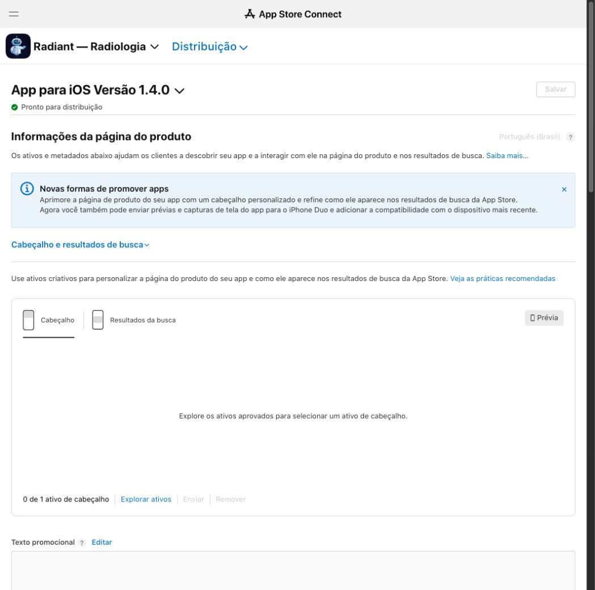

# Radiant 1.4.0 (12) — aprovação e liberação no Brasil

Medição: **2026-10-12, às 08:47 (America/Bahia)**.

## Evidência no App Store Connect

- App: Radiant — Radiologia, `6797078156`.
- Submissão: `a5e5a094-623e-4290-83b4-f1a9bb9d47cd`, enviada em
  2026-10-11 às 20:00, com estado "Revisão concluída".
- Quatro itens com status de revisão "Aprovado": versão `1.4.0 (12)`,
  Radiant Ilimitado Mensal, Radiant Ilimitado Anual e grupo Radiant Ilimitado.
- Build selecionada: `12`, versão `1.4.0`;
  identificador `7aa9c881-655b-4caa-bb70-46e994822008`.
- Binário previamente registrado no projeto: `221e2ec`.

O dono fez o login no navegador interno do Codex e autorizou prosseguir com
"Prossiga", depois do relatório que identificou a liberação manual como
próxima ação. O agente acionou "Liberar esta versão" e confirmou o diálogo
"Lançar o app iOS na App Store em 1 país ou região?", que listava Brasil.
Após a confirmação, o console passou de "Liberação do desenvolvedor pendente"
para **"Pronto para distribuição"** e retirou o botão de liberação.
A opção de atualização imediata para todos os usuários estava selecionada.

[Versão no console](https://appstoreconnect.apple.com/apps/6797078156/distribution/ios/version/inflight)
· [Envio aprovado](https://appstoreconnect.apple.com/apps/6797078156/distribution/reviewsubmissions/details/a5e5a094-623e-4290-83b4-f1a9bb9d47cd)



## Disponibilidade pública

A consulta pública brasileira, executada às **08:47:35**, ainda devolveu
`version: 1.3.1` e `currentVersionReleaseDate: 2026-09-14T21:45:06Z`.
A liberação no console já estava confirmada nessa medição.

Às **08:50**, a [página pública brasileira](https://apps.apple.com/br/app/radiant-radiologia/id6797078156)
mostrou **versão 1.4.0**, as novidades da 1.4 e compras dentro do app com
**Radiant Ilimitado Mensal: R$ 19,90** e **Anual: R$ 149,90**.
A publicação pública da nova versão está confirmada pela página da Apple.
O resultado inicial do `lookup` é uma medição anterior, não o estado atual.

Comando para remedir:

```bash
curl -s 'https://itunes.apple.com/lookup?id=6797078156&country=br' | python3 -c "import json,sys;print([(r['version'],r['currentVersionReleaseDate']) for r in json.load(sys.stdin)['results']])"
```

[App Store brasileira](https://apps.apple.com/br/app/radiant-radiologia/id6797078156)

## Validação local

Run documental: `run-1791805638154-3b32bebe`.
`loop validate` devolveu **`VALIDATION_PASSED`**, em um único ciclo:
**14/14 validadores aprovados**, incluindo documentação, conteúdo,
`app-quality`, `app-test`, lint/typecheck/testes da API e links do cérebro.
Os validadores do app usaram Node 20, `EXPO_NO_DOTENV=1` e `CI=1`, conforme
`.loop/project.yaml`; o controle do run usou Node 24. Após a confirmação da
página pública, `docs-contract` foi executado novamente sobre a documentação
final e passou. `git diff --check` também passou.
A aprovação da Apple e a publicação pública são evidências externas;
a validação local não substitui teste funcional no aparelho.
Nenhum código, build ou OTA novo foi produzido nesta liberação.
