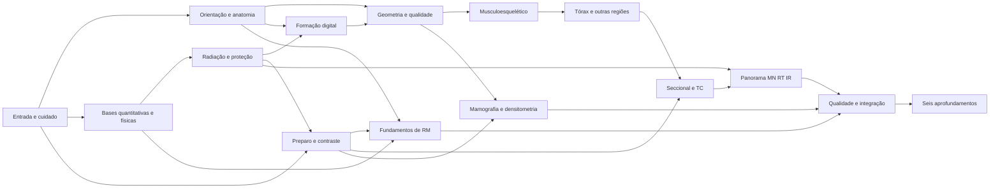

# Radiant — planejamento próprio de conteúdo

**Versão:** proposta1, 02/11/2026, America/Bahia. **Público decidido por Anderson:**
graduação tecnológica em Radiologia, seguida de especializações.
**Situação:** planejamento para revisão; nenhum conteúdo novo ativo.
A [ADR do reinício](../adr/ADR-2026-11-02-reinicio-conteudo-e-foco-tecnologo.md)
autoriza a retirada das aulas anteriores, inclusive exemplos e protótipos.
Esta é a **única sequência curricular proposta**. O
[anexo de pesquisa](../research/2026-11-02-pesquisa-conteudo-radiant.md) guarda
fontes/ementas/benchmarks; o [pipeline](../CONTENT_PIPELINE.md) guarda contratos
técnicos/direitos; [STATUS](../STATUS.md) e [FILA](../FILA.md) guardam execução.

## 1. Resultado pretendido e fronteira

O aluno deve conseguir explicar a formação de uma imagem, reconhecer estruturas
e orientação, avaliar critérios técnicos, escolher uma correção justificada e
reconhecer quando interromper uma ação simulada e pedir apoio. O Radiant apoia a
formação; não substitui laboratório, estágio, supervisão ou diploma, nem promete
habilitação, título de especialista ou diagnóstico autônomo.

A proposta contém **84 aulas de núcleo comum em14 módulos**, seguidas de
**48 aulas de aprofundamento em6 ramos**. São132 posições de planejamento, não132
aulas escritas. A duração de referência é4–7 min por aula curta; casos integradores
podem ter8–12 min com pausa/retomada. É hipótese de usabilidade a medir. Não converter
essas durações em carga horária acadêmica. Revisões e avaliações são atividades
próprias e não entram na contagem de aulas.

O primeiro lote proposto tem **somente M01, seis aulas**, antes de qualquer
produção ampla. O restante permanece mapa de cobertura. Não reutilizar textos,
perguntas, imagens, IDs de conteúdo ou aprovações das amostras aposentadas.

## 2. De onde virá o conteúdo sem compra de acervo

Acesso gratuito é requisito de aquisição da fonte; permissão de reutilização é
requisito independente para incorporar texto, figura, áudio ou imagem no app.
A biblioteca atual permanece preservada, mas sua presença não autoriza geração.

| Necessidade | Caminho recomendado | Restrição que precisa ser resolvida |
| --- | --- | --- |
| Anatomia | Virginia Tech Applied Human Anatomy, candidato CC BY; diagramas autorais revisados | Conferir edição/figuras e atribuir; não cobre toda anatomia por imagem. |
| Exames reais | Pequena seleção de coleções TCIA com licença compatível, começando por investigar LIDC-IDRI; artigos/figuras CC BY/CC0 encontrados via PMC/Open-i | Conferir o ativo e direitos de redistribuição/privacidade; não distribuir o acervo inteiro; faltam candidatos por modalidade. |
| Ilustrações | NIH BioArt e arquivos selecionados do Commons; desenho autoral de geometria/fluxos | Registrar licença por entrada; preservar exatidão e cumprir créditos/SA quando aplicável. |
| Física e segurança | Consulta a IAEA e fontes normativas brasileiras; autoria independente revisada, com evidências factual/normativa rastreáveis | Pacotes IAEA são restritos a reutilização não comercial. Não importar slides/texto para o produto nem para geração automática. |
| Mamografia/RT e atualização | Consulta ao INCA/Iowa e documentos institucionais; buscar ativos com direitos próprios antes de produzir | Materiais consultados têm NC-SA. Não adaptar sua expressão protegida ou seus bancos de exercícios para assinatura. |
| Ementa | Comparar IFPI, UNIFESP, UTFPR, IFPE e IFBA; especializações da Santa Casa/Senac/Fametro/FACENE/Unichristus/ICESP | Uma ementa ajuda a definir cobertura; não fornece licença para copiar aula nem equivalência acadêmica. |

As licenças e os links verificados estão em F01–F14 do anexo. OpenStax e Oregon
não estão liberados como acervo comercial: páginas atuais divergem de catálogos
antigos. `reference-only` continua fora de geração/publicação. Não contornar
isso por tradução, paráfrase automática ou troca de nomes.

**Rota recomendada:** fatos checados em fontes gratuitas + redação original por
autor responsável + ativos explicitamente licenciados + revisão técnica/editorial.
Não há fonte única gratuita encontrada que possa ser copiada integralmente para
cobrir este produto. Sem compra de conteúdo não significa sem trabalho de autoria,
tradução autorizada, curadoria ou revisão.

**Compatibilidade com a produção atual:** o contrato editorial de lote v1 admite
CC BY4.0 e múltipla escolha sem mídia. Uma licença comercialmente reutilizável
como CC BY3.0, condições próprias do BioArt, CC0 ou SA não está automaticamente
admitida nesse contrato. Exige classificação/revisão e eventual extensão explícita
antes de promoção. Priorizar candidatos CC BY4.0 e autoria própria no primeiro
lote; nenhuma política de licença foi ampliada nesta tarefa.

Antes de produzir cada aula, preencher um registro no contrato editorial existente:
objetivo observável, pré-requisitos, fontes/edição/data, localização da evidência,
direitos por ativo, erros esperados, rubrica, variantes inéditas, revisão e versão.
A fonte de uma afirmação e a licença da figura são campos distintos. Ausência de
licença ou revisão deixa o item bloqueado, sem fallback para conteúdo antigo.

## 3. Ordem lógica e dependências

A ordem deriva das ementas C01–C15 e é uma escolha pedagógica revisável.
As bases comuns começam com segurança/cuidado e linguagem espacial, seguem por
física/formação/qualidade e só então aplicações. A proteção reaparece dentro de
cada modalidade. Não deixar toda segurança para o fim.

A seta é dependência de conteúdo, não obrigação de cursar todos os ramos em
fila. Na navegação recomendada M10 aparece antes de M11; TC **não é pré-requisito
conceitual universal de RM**. Durante o piloto não implementar desbloqueios
adaptativos extras: primeiro validar o mapa e usar os serviços existentes.

### Linguagem das atividades

| Código | O aluno faz | Forma equivalente acessível |
| --- | --- | --- |
| Q1 | Escolhe uma decisão e confirma antes do retorno | Botões com estado/nome/ordem; leitor anuncia seleção e confirmação. |
| Q2 | Localiza estrutura/orientação em imagem sem rótulo da resposta | Lista estruturada ou região descrita sem fornecer o gabarito; verificar equivalência real. |
| Q3 | Compara duas imagens/diagramas e aponta diferença relevante | Vistas alternáveis com descrição e foco persistente; sem depender só de cor. |
| Q4 | Prevê efeito, ajusta controle e interpreta mudança na bancada | Incrementos/botões/campos; gesto nunca obrigatório; modelo e limitações declarados. |
| Q5 | Ordena etapas ou verifica uma lista de segurança | Mover para cima/baixo ou escolher próximo passo; ordem legível pelo leitor. |
| Q6 | Resolve minicaso com decisão, motivo e ação de apoio | Sequência de decisões explícitas; sem pontuar raciocínio clínico por palavra-chave livre. |

Q2/Q3 exigem imagem ou diagrama cientificamente revisado. Não substituir a
competência visual por texto que entrega a resposta: se a equivalência não for
possível, tratar como atividade complementar distinta e testar separadamente.
Q4 não deve ensinar relação numérica falsa por usar um modelo visual simplificado.

## 4. Núcleo comum — sequência de84 aulas

As descrições são **briefs**, não enunciados/gabaritos nem protocolos para uso em
pacientes. Cada módulo usa as fontes curriculares indicadas; os ativos/fontes
finais de cada afirmação serão selecionados antes da autoria. Identificadores
Mxx.yy são rótulos deste documento, não IDs persistidos no armazenamento do aluno.

### M01 — Entrar na profissão e cuidar

Pré-requisitos: entrada. Apoio curricular: C01/C02/C05 no anexo.

| Aula | Brief de competência | Prática principal |
| --- | --- | --- |
| M01.01 — O trabalho do tecnólogo | Distinguir tarefa técnica, decisão clínica e pedido de apoio. | Q1 |
| M01.02 — Identificação e comunicação | Verificar identidade e explicar uma etapa sem jargão. | Q5 |
| M01.03 — Biossegurança no percurso | Reconhecer barreiras e riscos num fluxo simulado. | Q5 |
| M01.04 — Segurança antes da imagem | Identificar uma condição que pede pausa e conferência. | Q6 |
| M01.05 — Consentimento, privacidade e acolhimento | Escolher comunicação respeitosa e proteger informação. | Q6 |
| M01.06 — Um percurso seguro | Integrar identificação, preparo e comunicação em caso inédito. | Q6 |

### M02 — Corpo, orientação e linguagem

Pré-requisitos: M01. Apoio curricular: C01/C02/C03 no anexo.

| Aula | Brief de competência | Prática principal |
| --- | --- | --- |
| M02.01 — Posição de referência e vistas | Relacionar corpo, observador e vista sem trocar lados. | Q2 |
| M02.02 — Lateralidade e marcadores | Conferir lado corporal e marcador em representações distintas. | Q3 |
| M02.03 — Planos e cortes | Relacionar plano, corte e orientação em modelo revisado. | Q4 |
| M02.04 — Estruturas e sistemas | Localizar relações básicas entre estruturas e sistemas. | Q2 |
| M02.05 — Da anatomia ao exame | Relacionar representação anatômica e região examinada. | Q3 |
| M02.06 — Orientar uma imagem nova | Transferir lateralidade e orientação sem rótulos de ajuda. | Q6 |

### M03 — Bases quantitativas e físicas

Pré-requisitos: M01; M02 pode correr em paralelo. Apoio curricular: C01/C03 no anexo.

| Aula | Brief de competência | Prática principal |
| --- | --- | --- |
| M03.01 — Unidades e ordens de grandeza | Comparar grandezas sem confundir unidade e quantidade. | Q1 |
| M03.02 — Proporção e leitura de gráficos | Interpretar variação e proporção em gráfico simples. | Q3 |
| M03.03 — Átomos e energia | Distinguir componentes e mudanças de energia em esquema. | Q2 |
| M03.04 — Ondas e espectro | Relacionar grandezas de onda em representação autoral. | Q4 |
| M03.05 — Eletricidade e magnetismo | Identificar relações físicas usadas nas modalidades. | Q3 |
| M03.06 — Escolher a relação física | Aplicar uma relação em situação inédita e justificar. | Q6 |

### M04 — Radiação, interação e proteção

Pré-requisitos: M03 + segurança M01. Apoio curricular: C01/C02/C03; N01/N02 no anexo.

| Aula | Brief de competência | Prática principal |
| --- | --- | --- |
| M04.01 — Produzir e detectar radiação | Ordenar a cadeia física num esquema validado. | Q5 |
| M04.02 — Interações com a matéria | Comparar efeitos relevantes para formação da imagem. | Q3 |
| M04.03 — Atenuação e espalhamento | Prever mudança qualitativa em modelo com limites claros. | Q4 |
| M04.04 — Efeitos biológicos | Distinguir conceitos de efeito e risco sem prognóstico individual. | Q1 |
| M04.05 — Justificação, otimização e monitoramento | Separar responsabilidades e contextos de exposição. | Q6 |
| M04.06 — Uma decisão de proteção | Reconhecer ação insegura e acionar apoio em caso novo. | Q6 |

### M05 — Formação da imagem digital

Pré-requisitos: M04; M02 para orientação. Apoio curricular: C01/C02/C03 no anexo.

| Aula | Brief de competência | Prática principal |
| --- | --- | --- |
| M05.01 — Do detector ao arquivo | Ordenar aquisição, conversão e apresentação. | Q5 |
| M05.02 — Pixel, matriz e campo de visão | Relacionar amostragem espacial em diagramas. | Q4 |
| M05.03 — Contraste, ruído e resolução | Distinguir dimensões de qualidade em pares de imagens. | Q3 |
| M05.04 — Processamento e apresentação | Separar dado adquirido de aparência exibida. | Q4 |
| M05.05 — DICOM, PACS e rastreabilidade | Reconhecer identificação, série e percurso do arquivo. | Q5 |
| M05.06 — Onde surgiu a falha | Localizar etapa provável sem confundir aparência com dose. | Q6 |

### M06 — Geometria, técnica e qualidade

Pré-requisitos: M02 + M05. Apoio curricular: C01/C03/C04 no anexo.

| Aula | Brief de competência | Prática principal |
| --- | --- | --- |
| M06.01 — Fonte, objeto e detector | Relacionar distância e geometria em modelo validado. | Q4 |
| M06.02 — Projeção e distorção | Comparar alinhamento e representação. | Q3 |
| M06.03 — Parâmetros de exposição | Prever efeitos qualitativos com limitações do simulador. | Q4 |
| M06.04 — Campo, colimação e espalhamento | Avaliar região útil e limites do campo em esquema. | Q4 |
| M06.05 — Movimento, nitidez e repetição | Escolher correção técnica e evitar repetição automática. | Q6 |
| M06.06 — Imagem tecnicamente adequada | Justificar aceitação ou escalonamento por critérios explícitos. | Q6 |

### M07 — Musculoesquelético e posicionamento

Pré-requisitos: M06. Apoio curricular: C01/C02/C05 no anexo.

| Aula | Brief de competência | Prática principal |
| --- | --- | --- |
| M07.01 — Membro superior | Relacionar marcos anatômicos e projeções introdutórias. | Q2 |
| M07.02 — Cintura escapular e articulações | Comparar alinhamento e cobertura anatômica. | Q3 |
| M07.03 — Membro inferior | Localizar estruturas e conferir orientação. | Q2 |
| M07.04 — Pelve e quadril | Avaliar representação e critérios técnicos básicos. | Q3 |
| M07.05 — Coluna vertebral | Relacionar regiões e posicionamento dentro do contexto simulado. | Q2 |
| M07.06 — Posicionar com limitações | Escolher adaptação e pedir apoio sem movimentação insegura. | Q6 |

### M08 — Tórax, abdome e cabeça

Pré-requisitos: M07; conhecimentos básicos de sistemas M02. Apoio curricular: C01/C02/C03 no anexo.

| Aula | Brief de competência | Prática principal |
| --- | --- | --- |
| M08.01 — Tórax e respiração | Relacionar estruturas e critérios técnicos do exame. | Q2 |
| M08.02 — Rotação e cobertura do tórax | Comparar imagens para identificar problema técnico. | Q3 |
| M08.03 — Abdome e sistemas | Localizar relações anatômicas e campo examinado. | Q2 |
| M08.04 — Crânio e face | Relacionar marcos, projeções e orientação. | Q2 |
| M08.05 — Variação de contexto e paciente | Escolher comunicação e adaptação técnica segura. | Q6 |
| M08.06 — Da solicitação à conferência | Integrar identificação, região e adequação em caso novo. | Q6 |

### M09 — Preparo, contraste e cuidado ampliado

Pré-requisitos: M01 + M04; antes de qualquer caso com contraste. Apoio curricular: C02/C07/C11 no anexo.

| Aula | Brief de competência | Prática principal |
| --- | --- | --- |
| M09.01 — Ler o protocolo e conferir preparo | Identificar informação faltante e solicitar conferência. | Q5 |
| M09.02 — Para que serve contraste | Distinguir finalidade e responsabilidades sem prescrever. | Q1 |
| M09.03 — Triagem e comunicação de riscos | Reconhecer informação que exige avaliação da equipe. | Q6 |
| M09.04 — Antes, durante e depois | Ordenar cuidados segundo protocolo validado. | Q5 |
| M09.05 — Reconhecer intercorrência e acionar ajuda | Escolher interrupção/comunicação, sem ensinar conduta médica independente. | Q6 |
| M09.06 — Um atendimento com barreiras | Integrar acessibilidade, identificação e escalonamento. | Q6 |

### M10 — Anatomia seccional e introdução à TC

Pré-requisitos: M08 + M09 + M05. Apoio curricular: C01/C03/C07 no anexo.

| Aula | Brief de competência | Prática principal |
| --- | --- | --- |
| M10.01 — Navegar por cortes | Relacionar sequência espacial e orientação. | Q4 |
| M10.02 — Tórax e abdome em secção | Localizar estruturas em vistas correspondentes. | Q2 |
| M10.03 — Cadeia de aquisição da TC | Ordenar movimento, aquisição e reconstrução. | Q5 |
| M10.04 — Reconstrução e apresentação | Comparar espessura, planos e janelas em material validado. | Q3 |
| M10.05 — Qualidade e indicadores de dose | Distinguir indicadores e qualidade sem estimar risco individual. | Q3 |
| M10.06 — Uma série tecnicamente coerente | Resolver caso introdutório de aquisição e conferência. | Q6 |

### M11 — Fundamentos próprios da RM

Pré-requisitos: M02 + M03 + M09; navegação após M10 é opcional. Apoio curricular: C01/C03/C07 no anexo.

| Aula | Brief de competência | Prática principal |
| --- | --- | --- |
| M11.01 — Segurança antes de entrar | Identificar informação que impede prosseguir sem avaliação. | Q6 |
| M11.02 — Campo, RF e componentes | Relacionar funções sem metáforas fisicamente falsas. | Q2 |
| M11.03 — Sinal e relaxação | Interpretar uma evolução esquemática revisada. | Q4 |
| M11.04 — Sequências e ponderação | Comparar contraste de imagem e parâmetros introdutórios. | Q3 |
| M11.05 — Bobina, posição e artefatos | Reconhecer relações com aquisição e qualidade. | Q3 |
| M11.06 — Conferir sem improvisar | Integrar segurança e adequação técnica em caso novo. | Q6 |

### M12 — Mamografia e densitometria

Pré-requisitos: M06 + M09; anatomia aplicada M02. Apoio curricular: C02/C05/C08 no anexo.

| Aula | Brief de competência | Prática principal |
| --- | --- | --- |
| M12.01 — Anatomia e acolhimento | Relacionar estruturas e cuidado respeitoso. | Q2 |
| M12.02 — Cadeia técnica da mamografia | Distinguir componentes e verificações introdutórias. | Q5 |
| M12.03 — Posicionamento e cobertura | Comparar critérios técnicos em imagens licenciadas. | Q3 |
| M12.04 — Qualidade e documentação | Escolher correção ou escalonamento sem emitir laudo. | Q6 |
| M12.05 — Fundamentos da densitometria | Relacionar medida, posicionamento e qualidade técnica. | Q3 |
| M12.06 — Duas modalidades, critérios distintos | Escolher critério adequado e comunicar limitação. | Q6 |

### M13 — Panorama de MN, RT e intervencionista

Pré-requisitos: M04 + M09 + M10; visão geral antes dos ramos. Apoio curricular: C01/C09/C11/C13 no anexo.

| Aula | Brief de competência | Prática principal |
| --- | --- | --- |
| M13.01 — Medicina nuclear no percurso | Distinguir origem do sinal e etapas do serviço. | Q5 |
| M13.02 — Proteção e rastreio em MN | Reconhecer contaminação, registro e necessidade de apoio. | Q6 |
| M13.03 — Radioterapia no cuidado oncológico | Relacionar finalidade, equipe e verificações. | Q5 |
| M13.04 — Simulação e posicionamento em RT | Distinguir imagem de localização e entrega de tratamento. | Q3 |
| M13.05 — Sala intervencionista | Reconhecer equipamentos, barreiras e suporte técnico. | Q2 |
| M13.06 — Escolher o percurso seguro | Distinguir papéis e verificações entre modalidades. | Q6 |

### M14 — Qualidade, gestão e integração

Pré-requisitos: M10 + M11 + M12 + M13. Apoio curricular: C01/C02/C03; N01/N02 no anexo.

| Aula | Brief de competência | Prática principal |
| --- | --- | --- |
| M14.01 — Garantia e controle de qualidade | Distinguir rotina, teste, registro e ação corretiva. | Q5 |
| M14.02 — Informação confiável e privacidade | Conferir registro e tratar inconsistência sem expor dados. | Q6 |
| M14.03 — Organização, acesso e humanização | Resolver fluxo com restrições e prioridades justificadas. | Q6 |
| M14.04 — Pesquisa e leitura crítica | Distinguir fonte, evidência, incerteza e afirmação comercial. | Q3 |
| M14.05 — Qualidade e responsabilidade socioambiental | Identificar destino e registro de materiais segundo serviço. | Q5 |
| M14.06 — Missão de integração do núcleo | Aplicar critérios em casos novos sem dicas de resposta. | Q6 |

### Cobertura parcial da graduação e decisões para PC03

O núcleo é apoio de estudo, não uma reprodução integral da graduação.
A comparação das matrizes revelou lacunas que precisam permanecer visíveis:

| Domínio | Cobertura proposta | Decisão antes da autoria/promoção |
| --- | --- | --- |
| Anatomia espacial e por imagem | M02/M07/M08/M10/M12 | Coberto em briefs; selecionar imagens e conferir amplitude por região. |
| Biologia celular e fisiologia | Introdução transversal em M02.04/M04.04 e sistemas de M08 | **Parcial.** Blueprint deve explicitar células/tecidos e funções relevantes antes das aplicações; dividir/ampliar aulas se necessário. |
| Patologia aplicada à aquisição | Casos de M07–M13, sem ensino de diagnóstico autônomo | **Parcial.** Incluir efeitos sobre preparo/posição/qualidade e limites profissionais revisados. |
| Odontológica | Não tem módulo próprio no núcleo 84 | **Pendente de recorte.** Conferir com docente se entra em bloco adicional de formação de imagem/qualidade; não alegar cobertura completa. |
| Ultrassom | Física de ondas em M03; sem percurso próprio | **Pendente.** Planejar visão técnica e limites de atuação antes de incluí-lo como modalidade coberta. |
| Radiologia industrial | Fora deste primeiro recorte clínico | Registrar como possível expansão; requer ementa, fontes e escopo profissional próprios. |
| Prática profissional/estágio | Apenas situações educacionais simuladas | Fora da equivalência do app; não substituir prática supervisionada por medalha. |

A revisão PC03 decide se o recorte é adequado ou se o mapa precisa crescer.
A contagem84+48 não pode esconder omissões nem justificar promover um módulo
sem os conhecimentos necessários. Esses pontos são pendências da proposta,
não competências já entregues ao aluno.

## 5. Aprofundamentos após o núcleo —48 aulas propostas

São percursos educacionais de aprofundamento, não especializações certificadas.
O aluno pode escolher um ramo; não precisa percorrer os seis em fila. A base
comum e uma verificação dos pré-requisitos específicos precedem o ramo.
As ementas de cursos técnicos, cursos livres e pós-graduações não são equivalentes.
O INCA2026/C15 não será apresentado como pós para tecnólogo.

| Ramo e fontes | Ordem de oito aulas | Prática e avaliação final |
| --- | --- | --- |
| **S-TC**, C03/C07 | 01 revisão seccional/segurança →02 instrumentação/aquisição →03 parâmetros, qualidade e indicadores de dose →04 reconstrução/apresentação →05 preparo/contraste →06 organização técnica por região/finalidade →07 artefatos/falhas →08 caso integrador | Q2/Q4/Q3/Q6; comparar série inédita e justificar conferência/correção. Não comprova operação real. |
| **S-RM**, C03/C07 | 01 física própria →02 equipamento/campos →03 riscos, triagem e barreiras →04 formação/sequências →05 parâmetros, contraste de imagem e tempo →06 posição/bobina/região →07 artefatos →08 caso integrador seguro | Q4/Q5/Q3/Q6; segurança sempre antes de qualquer simulação de entrada. Sem liberação de implante por decisão do app. |
| **S-MD**, C08 | 01 anatomia/acolhimento →02 equipamento/física/proteção →03 posicionamento mamográfico →04 critérios técnicos →05 tecnologias/complementos →06 fundamentos/instrumentação densitometria →07 posição/qualidade densitometria →08 caso integrado | Q2/Q3/Q6; avaliar cobertura e documentação. Sem emissão autônoma de diagnóstico/classificação de laudo. |
| **S-MN**, C09/C10 | 01 fundamentos nucleares/radiobiologia →02 percurso de radiofármacos →03 instrumentação/detecção →04 proteção/contaminação/rejeitos →05 preparo/orientação/posição →06 cintilografia/SPECT/qualidade →07 PET-CT/SPECT-CT →08 rastreabilidade do fluxo | Q5/Q3/Q6; localizar falha de processo. Não habilita manipulação/administração real de radiofármacos. |
| **S-RT**, C13/C14 | 01 paciente/equipe →02 física/radiobiologia/proteção →03 equipamentos/modalidades →04 posição/imobilização →05 simulação/localização/verificação →06 introdução ao planejamento/dosimetria →07 técnicas/controles/desvios →08 verificação e comunicação | Q2/Q5/Q6; reconhecer divergência e escalar. Não comprova planejamento clínico, entrega de tratamento ou formação de dosimetrista. |
| **S-IR**, C11/C12 | 01 anatomia vascular/seccional →02 imagem/equipamento →03 acessórios/sala →04 biossegurança/proteção →05 preparo/contraste/equipe →06 protocolos/posição/documentação →07 processamento/qualidade/otimização →08 suporte técnico integrado | Q2/Q5/Q6; preparar/verificar cenário simulado. Não ensina execução médica independente de ato invasivo. |

As posições01–08 de cada ramo serão desdobradas em briefs com a mesma estrutura
da seção4 depois da revisão do mapa. C06/C09 não expuseram toda ementa detalhada;
a ordem acima é inferência das fontes combinadas. Quantidade e escopo precisam
ser calibrados: assuntos densos podem exigir dividir aulas, sem transformar a
contagem132 em compromisso de lançamento.

## 6. Como a aula chega ao aluno

**Laço recomendado:** lembrar → prever → observar/operar → explicar → aplicar em
situação diferente → recuperar depois. Isso é estrutura didática, não obrigação
de repetir a mesma tela seis vezes. As evidências P01/P02 apoiam recuperação e
espaçamento; P03 apoia investigar intercalação. Nenhum estudo citado comprova
esta implementação específica ou habilitação profissional.

| Momento | Experiência | Questão/retorno | Evidência de aprendizagem |
| --- | --- | --- | --- |
| Entrada | “Hoje você vai conseguir…” em uma frase, situação concreta, duração estimada | Recuperar um pré-requisito; se faltar, oferecer reforço curto | Diagnóstico inicial separado da nota final. |
| Previsão | Pergunta ou comparação antes de mover o controle | Comprometer escolha e confirmar; sem gabarito em rótulo/acessibilidade/arte | Primeira resposta preservada. |
| Exploração guiada | Bancada, corte, sequência ou caso em passos | Um objetivo por interação; pista localizada, desfazer/repetir | Eventos de ajuda separados de resposta independente. |
| Explicação | Resultado ligado à decisão e fonte disponível | “Você mudou X; observe Y” e limite do modelo; alternativa errada tem motivo próprio | Não aceitar mero toque em “entendi” como domínio. |
| Transferência | Nova imagem, novo contexto ou parâmetro | Mesma competência em variante diferente, sem copiar a anterior | Acerto independente + justificativa estruturada. |
| Saída | Resumo de competência, próxima ação e revisão futura | “O que você consegue fazer agora” e uma recuperação final | Conclusão da sessão distinta de domínio consolidado. |
| Retorno | Fila com itens devidos e variedade de modalidades | Responder antes de revelar; ajuda continua disponível | Retenção atrasada e reaplicação. |

### Ordem de questões dentro e entre aulas

Para uma aula introdutória, propor **4–6 decisões**, mais exploração
livre orientada. Diagnóstico, previsão e assistência não se tornam evidência de
domínio por estarem na sessão; pontuação/XP dependem do papel de cada atividade
e dos contratos vigentes. Uma sequência candidata:1 pré-requisito →1 previsão →1 comparação
com ajuda opcional →1 aplicação sem ajuda →1 transferência →recuperação final se
necessária. Não inflar a sessão com duas questões que medem a mesma pista.

Após duas aulas, inserir prática intercalada de competências já introduzidas.
Ao fechar o módulo, propor avaliação curta com casos novos: relações/identificação,
decisão técnica e segurança, sem sequência previsível de respostas. O número e o
peso de cada domínio dependem do blueprint, não de copiar distribuição de prova
médica. Questões críticas de segurança são analisadas separadamente; uma média de
acertos não deve esconder uma decisão insegura.

Recuperação após erro: retorno específico →exemplo orientado diferente →nova
questão independente em outro contexto. Repetir o mesmo item depois de mostrar
a resposta não comprova recuperação. A primeira tentativa, ajuda e retomada
precisam permanecer distinguíveis nos contratos já existentes.

A agenda existente é o ponto de partida. Intervalos e critérios de domínio serão
calibrados com dados de retenção; não fixar um algoritmo novo porque um concorrente
usa determinada mecânica. Proposta de aceite educacional do piloto: evidência de
recuperação sem ajuda em variante e em retorno posterior. Limiar estatístico e
peso dos erros serão definidos com docente antes de virar bloqueio para o aluno.

### Variação com propósito

- **Laboratório de previsão:** manipular um fator, comparar antes/depois e explicar
  o efeito. Sem pontuação por arrastar muito ou decorar uma posição de slider.
- **Detetive da qualidade:** escolher qual imagem merece conferência e indicar a
  pista técnica; variar região, contexto e direção do defeito.
- **Navegação espacial:** alternar corpo/corte/imagem e voltar a uma vista estável;
  remover gradualmente as pistas, com controles alternativos equivalentes.
- **Percurso seguro:** ordenar verificações e decidir quando parar/chamar a equipe.
  Erro explica a barreira; não dramatizar dano real como diversão.
- **Caso em capítulos:** contexto →decisão →consequência técnica →nova informação;
  pausa/retomada em ponto seguro e sem duplicar XP/vidas.
- **Duelo de explicações:** selecionar motivo mais adequado entre alternativas
  plausíveis; evita que toda atividade seja reconhecimento por quatro botões.
- **Missão de revisão:** misturar competências devidas em2–4 min, com resposta
  antes da revelação. A revisão conserva sua identidade visual sem Pixel, conforme
  decisões Medalhão existentes; não importar mascote para essa tela por hábito.

## 7. Gamificação forte ligada a competência

A força vem de retorno frequente e significado, não de adicionar moedas sem fim.
Manter Medalhão, Pixel, estrelas, XP, metas e serviços existentes. Novas regras
abaixo são propostas para revisão, não alterações da economia entregue.

| Escala | Mecânica proposta | O que incentiva | Como evitar uma falsa vitória |
| --- | --- | --- | --- |
| Cada decisão | Retorno visual preciso + pista de progresso | Entender consequência e tentar outra estratégia | Sem recompensa extra por chutar rapidamente; gabarito após confirmação. |
| Aula | Cunhagem do medalhão e estrelas ligadas à evidência registrada | Concluir e recuperar competência | Distinguir conclusão, ajuda e retenção; repetição não cria novos efeitos financeiros/XP. |
| Módulo | Missão de integração com cenário novo | Transferir o que aprendeu | Só contar competência aprovada por rubrica, sem converter XP em diagnóstico de domínio. |
| Semana | Meta escolhida, distribuição de prática, revisão e retorno | Constância possível entre aula/plantão | Recuperar rotina sem linguagem de culpa; métrica de quantidade não apaga erros de segurança. |
| Percurso | Coleção de medalhas com significado explícito | Ver evolução de habilidades | Texto explica a evidência; selo educacional não diz “profissional habilitado”. |
| Exploração opcional | Desafios de variação e colecionáveis cosméticos aprovados | Curiosidade e escolha | Não exigir compra, publicidade ou competição para acessar orientação de segurança. |

Narrativa proposta: o aluno monta seu repertório de trabalho em missões de
observação, aquisição e conferência. Pixel acolhe, orienta atenção e celebra a
evolução em momentos breves; não vira narrador que interrompe toda questão.
Missão nunca exige expor caso de paciente, foto clínica ou dado pessoal.

Começar com metas pessoais e coleção individual. Ranking público, times, chat,
economia nova e eventos sazonais ficam para validação posterior, com necessidade
comprovada. Não são pré-requisito para uma experiência envolvente. P04/P05 mostram
que elementos têm efeitos distintos e badges sozinhos podem não melhorar desempenho.

**Vidas:** preservar a regra existente e seus contratos neste reset. O desenho
novo deve separar exploração guiada, prática pontuável e avaliação; qualquer
mudança de custo, recarga, compra ou acesso a reforço exige decisão de produto
própria. Propor teste com alunos sobre frustração e retorno antes de alterar.
Não confundir o pedido de pesquisa com autorização para reequilibrar assinaturas.

## 8. Direção visual, animação e microinterações

### Filosofia visual — domínio visível

A composição mantém o mundo Medalhão: grafite profundo, ouro como evidência de
avanço, Sora e controles com volume contido. Espaço e alinhamento organizam a
atenção; o centro visual pertence ao objeto que o aluno precisa compreender.
A execução deve cuidar de contorno, escala e contraste em cada estado.

O material sugere ferramenta de trabalho bem construída. Proporção e acabamento
substituem excesso de brilho. O ouro concentra significado; ícone, forma e texto
completam o estado, para que nenhuma informação dependa só de cor.

O ritmo alterna observar, agir e conferir. Uma imagem tem tempo e área para ser
vista; a interface responde ao gesto sem saltar entre medidas ou esconder partes
sob feedback. A qualidade aparece nos detalhes: foco estável, transição curta e
leitura contínua quando o aluno amplia a fonte.

Movimento mostra relação causal, passagem espacial ou confirmação. Celebração
ocupa o instante de uma conquista e termina. Sem movimento, a mesma informação
continua clara. O refinamento consiste em retirar disputa visual e deixar a
consequência da ação legível.

[Storyboard visual da proposta](../design/2026-11-02-conteudo-radiant-storyboard.png).
É estudo estático de composição/ritmo, não captura do app nem aula produzida.

| Evento | Resposta candidata | Duração de referência para protótipo | Reduce Motion / acesso |
| --- | --- | --- | --- |
| Pressionar controle | Depressão curta e retorno; valor responde imediatamente |80–120 ms | Estado por contraste/contorno; sem exigir sensação tátil. |
| Ajustar parâmetro | Visualização acompanha o valor, mantendo foco no efeito |Resposta contínua; sem esperar animação para agir | Campo/+/− e leitura do valor; descrição da mudança. |
| Confirmar resposta | Estado selecionado →confirmado →retorno localizado |120–180 ms | Texto e anúncio único; não depender de tremor/vermelho. |
| Mudar de etapa | Conteúdo entra com pouca amplitude e referência espacial estável |160–240 ms | Troca simples; foco no título/retorno correto. |
| Concluir aula | Medalhão recebe marca de progresso e assentamento breve |450–700 ms, pulável | Marca estática com resumo acessível; sem bloquear CTA. |
| Atualizar revisão/meta | Contagem real e uma confirmação sutil |150–250 ms | Número/texto final direto; sem loop. |

São valores de desenho para experimentar, não medidas atuais nem requisitos
científicos universais. Testar em aparelho, texto máximo e leitor de tela antes
de aprovar. Áudio/haptic opcionais, desligáveis e não exclusivos; evitar sobrepor
fala do leitor. Nenhuma animação deve modificar geometria científica só para ficar
mais atraente. Cenas didáticas têm pausar, avançar por etapa e repetir.

### Papel das tecnologias pedidas

| Recurso | Uso proporcional proposto | Condição antes de incorporar |
| --- | --- | --- |
| Reanimated/Skia e componentes atuais | Base nativa para feedback, diagramas, controles e Medalhão | Reutilizar contratos de foco/retomada, medir renderização e consumo. |
| Motion/Framer e GSAP | Estudos web de ritmo/composição se necessários | Protótipo web não prova comportamento React Native; não criar dependência no app por analogia. |
| Rive | Candidato para estados interativos do Pixel/objeto quando houver benefício verificável | Validar runtime existente/necessário, máquina de estados, acessibilidade, licença e custo de bundle. |
| Lottie / text-to-Lottie | Candidato para acento finito/celebração, com contrato de reprodução e quadro estático | Gerar JSON não prova compatibilidade do player nativo; verificar em aparelho antes de adotar. |
| Three.js/3D | Candidato somente para relação espacial que2.5D não explique bem | Validar correção anatômica, gestos equivalentes, aparelho modesto, offline e bateria. Sem modelo clínico gerado sem revisão. |
| Expo UI | Consultado como opção de controles nativos | O projeto atual usa SDK 54; a skill consultada descreve camada universal SDK 56+. Não migrar SDK nem instalar pacote como efeito do planejamento. |

Humanizer orienta frases diretas, motivos específicos e ausência de culpa; UI UX
Pro Max/Taste/Impeccable orientam hierarquia e estados sem criar outro sistema
visual. Genjutsu segue a direção de melhorar o mundo existente, sem redesenho da
marca. Canvas Design fundamenta a filosofia e o storyboard. As bibliotecas são
alternativas por necessidade, não uma lista de dependências obrigatórias.
XTool/instalador/Build iOS só serão pertinentes numa etapa autorizada de validação
nativa. Não foram acionados para pesquisa documental ou para instalar aplicativos.

### Lacuna entre a proposta e o lote editorial atual

Os motores existentes têm interações variadas, mas o contrato de publicação de
lotes v1 continua limitado a múltipla escolha sem mídia. Isso impede declarar
Q2–Q6 publicáveis só porque há um renderer. PC05 deve especificar a extensão de
schema/proveniência/rubrica/acessibilidade e testes necessária para cada família;
PC06 só implementa o recorte aprovado. Não disfarçar uma bancada ou imagem dentro
de um payload de múltipla escolha para contornar a validação. O piloto pode
começar com o formato admitido e um protótipo separado revisável, sem promover
conteúdo incompleto. Essa é uma dependência de entrega, não uma funcionalidade
já implementada por este planejamento.

## 9. Produção, revisão e rastreabilidade

1. **Blueprint:** docente/autor liga objetivo, pré-requisito, erro e rubrica à
   cobertura do mapa. A pergunta nasce da competência, não da disponibilidade de
   uma imagem bonita.
2. **Dossiê de fontes:** registrar referência factual e direitos de cada ativo;
   impedir uso de fonte bloqueada/reference-only em prompts ou exportação.
3. **Autoria:** escrever conteúdo original curto e alternativas plausíveis;
   deixar explícito o limite de simuladores. Não copiar questão de concurso/app.
4. **Revisão técnica e editorial:** profissional qualificado por modalidade
   confere fatos, papéis, termos, normas vigentes e adequação do nível.
5. **Revisão didática/acessível:** verificar pistas involuntárias, resposta antes
   do feedback, equivalência dos controles, leitura e texto máximo.
6. **Protótipo do lote:** usar contratos e motores atuais; novas interações só
   depois de especificação revisável. Pipeline valida schema, fontes e direitos.
7. **Teste com público:** estudantes realizam tarefas com variantes inéditas,
   retornam após intervalo e relatam dificuldades. Medir aprendizagem e acesso.
8. **Promoção explícita:** somente itens aprovados entram num catálogo versionado;
   zero aulas aprovadas mantém estado retirado. Reset/migração de dados pessoais,
   build e publicação têm escopo e autorização próprios.

IDs finais devem separar identidade de competência, versão de conteúdo, item e
variante. Não reciclar `lesson-1`, H4, bancada ou L1/L2; progresso antigo não pode
validar uma aula nova só porque o rótulo coincide. A definição concreta de IDs e
compatibilidade entra no contrato do primeiro lote, antes de ativá-lo. O reset
atual não limpa nem transforma histórico do aluno.

## 10. Piloto, métricas e critérios de avanço

Proposta de piloto com5–8 estudantes de fases iniciais e2 docentes/revisores, amostra
formativa sem pretensão de estimar eficácia. Adaptar recrutamento e permissões
institucionais quando aplicáveis. Não registrar pacientes ou dados clínicos reais.
Esses participantes ainda não foram recrutados; os números são planejamento.

- **Compreensão:** explicar a própria escolha, transferir para variante inédita e
  recuperar após intervalo; comparar pré/pós sem expor gabaritos idênticos.
- **Segurança:** analisar cada erro crítico e sua recuperação, separado da média.
- **Experiência:** conseguir iniciar/pausar/retomar; entender o retorno; controlar
  movimento/áudio; completar as tarefas com leitor e texto máximo.
- **Hábito:** retornar por escolha, usar revisão e distribuir prática. Constância
  complementa aprendizagem; não é sua substituta.
- **Qualidade técnica:** resposta fluida, nenhum efeito duplicado, estado íntegro
  após interrupção e funcionamento offline em ambiente autorizado.

Critérios de avanço: nenhuma falha crítica científica/de direitos/acessibilidade
sem tratamento; compreensão suficiente observada para revisar o lote; ações
corretivas registradas e rechecadas. Não declarar sucesso por satisfação, tempo
na tela ou testes automatizados sozinhos. Definir limiares quantitativos com os
revisores após observar variabilidade, antes de testar expansão do currículo.

## 11. Plano de execução próprio

| Etapa | Entrega concreta | Dependência | Dono proposto / aceite |
| --- | --- | --- | --- |
| PC01 | Retirada integral, catálogo explícito e auditoria técnica | Autorização já dada | Agente; guardas e validação configurada; prova na evidência. |
| PC02 | Este mapa, pesquisa e storyboard | PC01 antes de pesquisar | Agente; revisão de fontes/ordem/direitos e documentação única. |
| PC03 | Revisão do público, cobertura84+48 e recorte de seis aulas | PC02 | Anderson + docente; registrar alterações aceitas. Não repetir autorização de apagar. |
| PC04 | Seis briefs M01 com fontes/ativos liberados e rubricas | PC03 | Autor/editor/revisor de radiologia; nenhum item sem direitos ou revisão. |
| PC05 | Especificação de questões/variantes, IDs e contrato do primeiro lote | PC04 | Produto+engenharia; revisão de retomada, evidência e compatibilidade. |
| PC06 | Protótipo nativo do lote e microinterações prioritárias | PC05 e autorização de implementação | Agente; testes de comportamento/acesso e prova nativa própria. |
| PC07 | Piloto e retenção atrasada; ajustes | PC06 | Docente+alunos; resultados e falhas, sem alegar validação clínica. |
| PC08 | Produção por módulos e ramos escolhidos | PC07 aceito | Autor/revisor; lotes pequenos versionados, sem geração em massa não revisada. |
| PC09 | Migração/restauração e candidato de distribuição | Conteúdo aprovado + escopo específico | Engenharia/Anderson; autorização e gates próprios. Não iniciado aqui. |

Pendências não impedem revisar a proposta concreta: aprovar/ajustar mapa e primeiro
lote, nomear revisão técnica e selecionar os primeiros ativos licenciados.
Workflow operacional permanece na FILA/Trello quando autorizado; não criar uma
lista pessoal no Todoist nem duplicar este plano em outro sistema. Aulas completas
para escrita/revisão posterior terão documento de produção adequado; este arquivo
é especificação técnica/editorial do produto.

## 12. Aceite e evidência desta etapa

A retirada e os testes são descritos na
[auditoria de02/11](../evidence/2026-11-02-retirada-conteudo-radiant.md), incluindo
perdas de roteiros E2E e limites. O plano é revisável: nenhuma recomendação aqui
significa que uma biblioteca foi instalada, que uma aula foi escrita, que a
sequência foi aprovada clinicamente ou que houve publicação.
