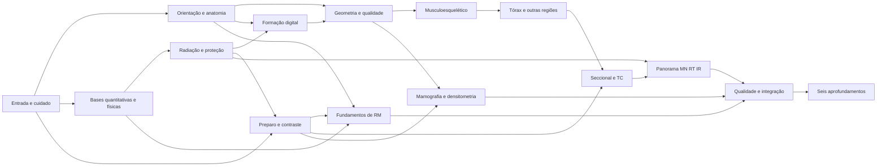

# Radiant: planejamento próprio de conteúdo

**Versão:** proposta 2, 02/11/2026, America/Bahia. **Público decidido por Anderson:**
graduação tecnológica em Radiologia, seguida de especializações.
**Situação em 02/11/2026:** PC03-A aprovado por Anderson para iniciar PC04 e PC05;
aceite editorial do piloto (PC03-B) pendente; nenhum conteúdo novo ativo.
**Atualização de 03/11/2026:** base técnica do PC05 implementada; primeira
[conferência dos payloads reais](../evidence/2026-11-03-pc05-payloads.md) executada,
com quatro lacunas de checkpoint e integrações ainda pendentes. PC03-B recebeu aceite técnico/editorial por IA do Claude em 03/11; cinco briefs e M01.01 completa revisados, com três ajustes menores conferidos. Anderson aprovou em 03/11 o crédito/CC BY 4.0 delimitados dos diagramas e o uso didático delimitado da bancada. [Parecer](../evidence/2026-11-03-pc03b-revisao-claude.md). [Pacote de revisão](../evidence/2026-11-03-pc04-pacote-piloto.md). [Contrato e transição](../CONTENT_PIPELINE.md#pc05--extensão-explícita-do-piloto-03112026).
**Atualização de 05/11/2026, 20:30:** a
[ADR da delegação](../adr/ADR-2026-11-05-delegacao-de-decisao-e-producao-ampla.md)
muda três pontos deste plano: a revisão por IA independente substitui os aceites
pendentes, o PC07 deixa de ser condição do PC08 e a aula passa a ter cinco
interações num contrato amplo. O mapa das seções 5 a 7 continua sendo a sequência
curricular. A execução está no
[plano de trilha ampla e engajamento](2026-11-05-radiant-trilha-ampla-e-engajamento.md).
A [ADR do reinício](../adr/ADR-2026-11-02-reinicio-conteudo-e-foco-tecnologo.md)
autoriza a retirada das aulas anteriores, inclusive exemplos e protótipos.
Esta é a **única sequência curricular proposta**. O
[anexo de pesquisa](../research/2026-11-02-pesquisa-conteudo-radiant.md) guarda
fontes, ementas e benchmarks; o [pipeline](../CONTENT_PIPELINE.md) guarda contratos
técnicos e direitos; [STATUS](../STATUS.md) e [FILA](../FILA.md) guardam a execução.
A proposta 1 (Codex, commit `30c95b0`) foi revisada pelo Claude no mesmo dia; a
[seção 15](#15-o-que-mudou-da-proposta-1) lista as mudanças.

## 0. Decisões do PC03-A — aprovadas em 02/11/2026

**Decisor:** Anderson Melo, nas respostas explícitas desta conversa. Esta seção
é o registro canônico das seis decisões de produto; a
[ADR](../adr/ADR-2026-11-02-reinicio-conteudo-e-foco-tecnologo.md#complemento-pc03--autorização-de-produto-e-aceite-editorial)
registra a separação dos gates. A autorização permite iniciar PC04 e PC05.

1. **Revisão indicada: Claude.** Anderson respondeu “o claude pode fazer a
   revisão” ao pedido de revisão técnica de radiologia e editorial. Claude
   realizou essa revisão por IA em 03/11/2026, com fontes rastreáveis e limites declarados; parecer favorável registrado no PC03-B.
   A indicação não significa revisão realizada, qualificação profissional ou
   aprovação clínica. Os critérios de fontes, direitos, revisão e segurança
   das seções 1 e 11 continuam exigíveis; participantes do piloto vêm depois.
2. **Primeiro lote aprovado.** Piloto em fatia vertical da
   [seção 4](#4-piloto-em-fatia-vertical): cinco aulas de três módulos,
   em lugar das seis aulas de M01. O recorte está aprovado; os briefs e a aula
   completa foram produzidos no PC04 e receberam aceite editorial por IA no PC03-B em 03/11/2026; direitos dos quatro diagramas foram aprovados por Anderson no recorte delimitado do [pacote PC04](../evidence/2026-11-03-pc04-pacote-piloto.md).
3. **Navegação aprovada para testar.** Alternar M02 com M03/M04 e testar uma
   primeira manipulação na primeira sessão, conforme a
   [seção 5](#5-ordem-dependências-e-navegação). A aprovação não afirma eficácia
   nem fixa o resultado do teste com alunos.
4. **Nivelamento aprovado.** Prever avaliação na entrada de cada ramo para
   formados, sem obrigá-los a cursar as 84 aulas do núcleo. O desenho e a
   implementação ficam no PC08, após o piloto aceito.
5. **Transição aprovada.** Preservar os dados e conquistas existentes; ao abrir
   uma aula retirada, mostrar aviso claro e oferecer acesso à nova trilha.
   Não converter progresso antigo em conclusão das aulas novas. PC05 define
   texto, caminhos e compatibilidade antes de qualquer build; nada disso foi
   implementado por esta aprovação.
6. **Release conjunto confirmado.** A retirada só entra na `main` junto com o
   primeiro lote aprovado. PC09 mantém autorização e gates próprios; esta
   decisão não autoriza build, merge ou publicação agora.

**Separação aprovada por Anderson:** PC03-A é a autorização de produto acima;
PC03-B é o aceite editorial do mapa e do piloto depois da produção do PC04.
PC03-B continua obrigatório antes do PC06. Assim, a aula completa exigida para o
aceite pode ser escrita sem presumir que já foi aprovada.

## 1. Resultado pretendido, aceite e limites

O aluno deve conseguir explicar a formação de uma imagem, reconhecer estruturas
e orientação, avaliar critérios técnicos, escolher uma correção justificada e
reconhecer quando interromper uma ação simulada e pedir apoio. O Radiant apoia a
formação. Ele não substitui laboratório, estágio, supervisão ou diploma, e não
promete habilitação, título de especialista ou diagnóstico autônomo.

A proposta tem **84 aulas de núcleo comum em 14 módulos** e **48 aulas de
aprofundamento em 6 ramos**. São 132 posições de planejamento. Em 05/11/2026,
M01.01 está revisada pelo PC03-B, e as outras quatro aulas do piloto estão escritas
como rascunho de IA, sem revisão independente. Seis aulas por módulo é a estimativa de partida; o blueprint de cada
módulo fixa o tamanho final. A duração de referência é de 4 a 7 minutos por aula
curta, e casos integradores podem ter de 8 a 12 minutos com pausa e retomada. É
hipótese de usabilidade a medir, e não vira carga horária acadêmica. Revisões e
avaliações são atividades próprias e não entram na contagem de aulas.

**Autorização de produto (PC03-A):** concluída com as seis decisões da seção 0;
libera a produção do PC04 e o contrato do PC05 em paralelo.

**Aceite técnico/editorial por IA do mapa e do piloto (PC03-B): aceito pelo
Claude em 03/11/2026.** A revisão cobriu ordem/cobertura do mapa, cinco briefs,
M01.01 completa e quatro PNGs. Os três ajustes menores foram conferidos, sem
novos achados; [parecer e evidência](../evidence/2026-11-03-pc03b-revisao-claude.md).
Não é aprovação clínica. Anderson aprovou separadamente crédito/licença dos
diagramas e uso didático da bancada em 03/11/2026, nos limites do
[registro de aceite](../evidence/2026-11-03-pc03b-revisao-claude.md#aceites-posteriores-de-anderson-03112026).
PC04 está concluído nesse recorte; PC05 teve a primeira conferência real, com
as lacunas e integrações registradas no pacote. PC06 mantém essas
dependências e autorização de implementação. VoiceOver é prova de saída do PC06,
pois depende do protótipo. A integridade offline era também; por decisão de Anderson
em 04/11/2026, ela passa ao primeiro lote promovido, sobre o conteúdo real, porque o
grafo de release exclui as prévias.

**Sempre:** fonte factual e direito de uso registrados por ativo; resposta
confirmada antes do retorno; primeira tentativa, ajuda e retomada distinguíveis;
erro crítico de segurança analisado à parte da média; controles alternativos ao
gesto; texto equivalente que não entrega o gabarito.

**Perguntar antes:** ampliar a política de licenças do contrato; mudar vidas,
custo, recarga, compra ou acesso a reforço; adicionar dependência de animação ou
3D; migrar SDK; recrutar participantes; qualquer build, migração ou publicação.

**Nunca:** reutilizar textos, perguntas, imagens, IDs de conteúdo ou aprovações
das amostras aposentadas; usar fonte `reference-only` em geração ou publicação;
contornar licença por tradução, paráfrase automática ou troca de nomes; esconder
bancada ou imagem dentro de um payload de múltipla escolha para passar na
validação; registrar paciente ou dado clínico real.

## 2. De onde virá o conteúdo sem compra de acervo

Acesso gratuito é requisito de aquisição da fonte. Permissão de reutilização é
requisito independente para incorporar texto, figura, áudio ou imagem no app. A
biblioteca atual permanece preservada, e sua presença não autoriza geração.

| Necessidade | Caminho recomendado | Restrição que precisa ser resolvida |
| --- | --- | --- |
| Anatomia | Virginia Tech Applied Human Anatomy, candidato CC BY; diagramas autorais revisados | Conferir edição e figuras e atribuir; não cobre toda a anatomia por imagem. |
| Exames reais | Pequena seleção de coleções TCIA com licença compatível, começando por investigar LIDC-IDRI; artigos e figuras CC BY/CC0 encontrados via PMC/Open-i | Conferir o ativo e os direitos de redistribuição e privacidade; não distribuir o acervo inteiro; faltam candidatos por modalidade. |
| Ilustrações | NIH BioArt e arquivos selecionados do Commons; desenho autoral de geometria e fluxos | Registrar licença por entrada; preservar exatidão e cumprir créditos e SA quando aplicável. |
| Física e segurança | Consulta a IAEA e a fontes normativas brasileiras; autoria independente revisada, com evidências factual e normativa rastreáveis | Pacotes IAEA são restritos a reutilização não comercial. Não importar slides ou texto para o produto nem para geração automática. |
| Mamografia, RT e atualização | Consulta ao INCA, a Iowa e a documentos institucionais; buscar ativos com direitos próprios antes de produzir | Os materiais consultados têm NC-SA. Não adaptar sua expressão protegida nem seus bancos de exercícios para assinatura. |
| Ementa | Comparar IFPI, UNIFESP, UTFPR, IFPE e IFBA; especializações da Santa Casa, Senac, Fametro, FACENE, Unichristus e ICESP | A ementa ajuda a definir cobertura; não dá licença para copiar aula nem equivalência acadêmica. |

As licenças e os links verificados estão em F01–F14 do anexo. OpenStax e Oregon
não estão liberados como acervo comercial, porque as páginas atuais divergem de
catálogos antigos. `reference-only` continua fora de geração e publicação.

**Rota recomendada:** fatos checados em fontes gratuitas, redação original por
autor responsável, ativos explicitamente licenciados e revisão técnica e
editorial. Nenhuma fonte gratuita encontrada pode ser copiada inteira para cobrir
este produto. Dispensar a compra de conteúdo não dispensa autoria, tradução
autorizada, curadoria ou revisão.

**Compatibilidade com a produção atual.** O contrato editorial de lote v1 exige
que toda fonte seja CC BY 4.0 e só admite múltipla escolha sem imagem
([`EditorialBatchContract.ts`](../../radiant-app/src/features/student-checkpoints/EditorialBatchContract.ts)).
O PC05 acrescenta uma extensão explícita para as quatro famílias do piloto e
diagramas autorais em CC BY 4.0; não altera o caminho v1 sem extensão.
CC BY 3.0, as condições próprias do BioArt, CC0 e SA não estão admitidas e exigem
classificação, revisão e extensão explícita antes de promoção. A única coleção de
imagens reais candidata, LIDC-IDRI, é CC BY 3.0; por isso o piloto usa diagramas
autorais. Nenhuma política de licença foi ampliada nesta tarefa.

Antes de produzir cada aula, preencher um registro no contrato editorial
existente: objetivo observável, pré-requisitos, fontes com edição e data,
localização da evidência, direitos por ativo, erros esperados, rubrica, variantes
inéditas, revisão e versão. A fonte de uma afirmação e a licença da figura são
campos distintos. Sem licença ou revisão, o item fica bloqueado, sem fallback
para conteúdo antigo.

## 3. Atividades e os motores que já existem

As seis famílias de prática correspondem a tipos de interação que o app já
declara em [`learningActivity.ts`](../../radiant-app/src/types/learningActivity.ts).
Cinco têm renderer registrado em
[`ActivityRendererRegistry.tsx`](../../radiant-app/src/features/lesson-flow/renderers/ActivityRendererRegistry.tsx);
a sexta tem só o tipo. Conferido no código em 02/11/2026.

| Código | O aluno faz | Interação | Renderer | V1 sem extensão | Aulas do núcleo |
| --- | --- | --- | --- | --- | --- |
| Q1 | Escolhe uma decisão e confirma antes do retorno | `multiple-choice` | registrado | aceito, sem imagem | 4 |
| Q2 | Localiza estrutura ou orientação em imagem sem rótulo da resposta | `hotspot` | registrado | recusado | 13 |
| Q3 | Compara duas imagens ou diagramas e aponta a diferença relevante | `comparison` | registrado | recusado | 18 |
| Q4 | Prevê o efeito, ajusta o controle e interpreta a mudança na bancada | `bench` (`parameter-lab` tem tipo, sem renderer) | registrado | recusado | 10 |
| Q5 | Ordena etapas ou verifica uma lista de segurança | `ordering` | registrado | recusado | 13 |
| Q6 | Resolve minicaso com decisão, motivo e ação de apoio | `case-decision` | textual registrado em 03/11, PC06-D | recusado | 26 |

`matching` também tem renderer e não aparece no plano.

**PC05, 03/11/2026:** a extensão explícita `pilot` aceita Q1–Q5, com diagrama
autoral CC BY 4.0, rubrica, alternativa acessível, fontes, variantes e hash dos
metadados. A tabela descreve o v1 sem essa extensão. Q6 continua recusado.
**PC06-D, 03/11/2026:** renderer textual registrado com contexto e fases
opcionais em capítulos explícitos; isso não amplia o contrato editorial.
[Evidência e limites](../evidence/2026-11-03-pc06d-renderer-case-decision.md).
O [contrato técnico](../CONTENT_PIPELINE.md#pc05--extensão-explícita-do-piloto-03112026)
registra campos, restrições, IDs e transição. Nenhuma atividade real foi promovida.

Duas consequências mudam a ordem do trabalho. Ampliar o contrato para Q2–Q5 é
liberar quatro famílias que já renderizam, com schema, proveniência, rubrica,
acessibilidade e testes próprios de cada uma. Q6 é a prática principal de 31% do
núcleo. O renderer textual foi entregue no PC06-D; contrato editorial, conteúdo
revisado e provas nativas permanecem necessários antes de publicar aulas Q6.

| Código | Forma equivalente acessível |
| --- | --- |
| Q1 | Botões com estado, nome e ordem; o leitor anuncia seleção e confirmação. |
| Q2 | Lista estruturada ou região descrita sem fornecer o gabarito; verificar equivalência real. |
| Q3 | Vistas alternáveis com descrição e foco persistente; sem depender só de cor. |
| Q4 | Incrementos, botões ou campos; gesto nunca obrigatório; modelo e limitações declarados. |
| Q5 | Mover para cima e para baixo ou escolher o próximo passo; ordem legível pelo leitor. |
| Q6 | Sequência de decisões explícitas; sem pontuar raciocínio clínico por palavra-chave livre. |

Q2 e Q3 exigem imagem ou diagrama cientificamente revisado. Quando a
equivalência em texto entregaria a resposta, a atividade complementar é distinta
e testada separadamente. Q4 não pode ensinar relação numérica falsa por usar um
modelo visual simplificado.

## 4. Piloto em fatia vertical

O piloto testa os riscos reais do produto num lote pequeno: o pipeline editorial
no formato já aceito, uma competência visual com diagrama autoral, a bancada e
uma sequência de segurança. Seis aulas de M01 não testariam nada disso, porque
M01 é o módulo menos visual, depende de protocolo de cada instituição e usa Q6
em três das seis aulas.

| Aula | Prática | O que o piloto testa | O que precisa existir antes |
| --- | --- | --- | --- |
| M01.01 — O trabalho do tecnólogo | Q1 | Pipeline editorial completo no contrato v1, sem extensão | Fonte CC BY 4.0 e revisão |
| M01.02 — Identificação e comunicação | Q5 | Sequência de segurança e leitura da ordem pelo leitor de tela | Extensão do contrato para `ordering` |
| M02.01 — Posição de referência e vistas | Q2 | Localização em diagrama autoral sem rótulo da resposta | Extensão para `hotspot` com ativo autoral |
| M02.02 — Lateralidade e marcadores | Q3 | Comparação visual numa competência crítica para segurança | Extensão para `comparison` com ativo autoral |
| M06.04 — Campo, colimação e espalhamento | Q4 | Bancada com o motor genérico de colimação existente; a [ADR de 24/10](../adr/ADR-2026-10-24-aula-bancada-fisica-digital-e-colimacao.md) mantém aval científico do dono pendente | Extensão para `bench`, cena abstrata nova e revisão técnica; sem reaproveitar aula retirada |

M06.04 entra fora da ordem do mapa de propósito: o piloto é formativo e mede o
motor, não a sequência. Q6 fica fora do piloto até ter renderer, contrato editorial e aceites próprios. Uma das
cinco aulas é escrita por inteiro já no PC04 e serve de objeto de aceite do mapa.

**Primeira vitória.** O exercício de kV das boas-vindas era a manipulação que o
aluno fazia no primeiro uso, e saiu com a retirada. Hoje a primeira sessão de um
aluno novo é a apresentação sem prática. O piloto deve medir se uma manipulação
curta na primeira sessão (candidata: um ajuste de bancada autoral) melhora o
retorno ao app, antes de o PC08 fixar a primeira aula do núcleo.

## 5. Ordem, dependências e navegação

A ordem deriva das ementas C01–C15 e é uma escolha pedagógica revisável. As bases
comuns começam com segurança e linguagem espacial, seguem por física, formação e
qualidade e só então chegam às aplicações. A proteção reaparece dentro de cada
modalidade, em vez de ficar toda no fim.

A seta é dependência de conteúdo, e o aluno não precisa cursar todos os ramos em
fila. Na navegação recomendada M10 aparece antes de M11, mas TC **não é
pré-requisito conceitual universal de RM**.

**Navegação proposta.** Seguida em fila, a sequência põe M03 e M04 (12 aulas de
física e proteção) antes do primeiro contato com formação de imagem, e o primeiro
posicionamento só chega em M07, depois de 36 aulas. As matrizes C02 e C04 dão
anatomia e física em paralelo no primeiro semestre. A navegação aprovada no
PC03-A alterna aulas de M02 com aulas de M03/M04, para que uma representação de imagem
apareça já nas primeiras sessões. Seu efeito é hipótese para o PC07 medir.

**Nivelamento para quem já é formado.** O grafo exige M14 antes de qualquer ramo,
o que obrigaria um tecnólogo formado a refazer o núcleo inteiro para chegar a TC.
A decisão do PC03-A aprova uma avaliação de nivelamento na entrada de cada ramo,
com casos novos dos pré-requisitos daquele ramo. Durante o piloto nada disso é
implementado: primeiro se valida o mapa com os serviços que já existem.

## 6. Núcleo comum: sequência de 84 aulas

As descrições são **briefs**, não enunciados, gabaritos ou protocolos para uso em
pacientes. Cada módulo usa as fontes curriculares indicadas; os ativos e as
fontes finais de cada afirmação serão selecionados antes da autoria. Os
identificadores Mxx.yy são rótulos deste documento, não IDs persistidos no
armazenamento do aluno. As aulas do piloto estão marcadas com ★.

### M01 — Entrar na profissão e cuidar

Pré-requisitos: entrada. Apoio curricular: C01/C02/C05 no anexo.

| Aula | Brief de competência | Prática principal |
| --- | --- | --- |
| M01.01 — O trabalho do tecnólogo ★ | Distinguir tarefa técnica, decisão clínica e pedido de apoio. | Q1 |
| M01.02 — Identificação e comunicação ★ | Verificar identidade e explicar uma etapa sem jargão. | Q5 |
| M01.03 — Biossegurança no percurso | Reconhecer barreiras e riscos num fluxo simulado. | Q5 |
| M01.04 — Segurança antes da imagem | Identificar uma condição que pede pausa e conferência. | Q6 |
| M01.05 — Consentimento, privacidade e acolhimento | Escolher comunicação respeitosa e proteger informação. | Q6 |
| M01.06 — Um percurso seguro | Integrar identificação, preparo e comunicação em caso inédito. | Q6 |

### M02 — Corpo, orientação e linguagem

Pré-requisitos: M01. Apoio curricular: C01/C02/C03 no anexo.

| Aula | Brief de competência | Prática principal |
| --- | --- | --- |
| M02.01 — Posição de referência e vistas ★ | Relacionar corpo, observador e vista sem trocar lados. | Q2 |
| M02.02 — Lateralidade e marcadores ★ | Conferir lado corporal e marcador em representações distintas. | Q3 |
| M02.03 — Planos e cortes | Relacionar plano, corte e orientação em modelo revisado. | Q4 |
| M02.04 — Estruturas e sistemas | Localizar relações básicas entre estruturas e sistemas. | Q2 |
| M02.05 — Da anatomia ao exame | Relacionar representação anatômica e região examinada. | Q3 |
| M02.06 — Orientar uma imagem nova | Transferir lateralidade e orientação sem rótulos de ajuda. | Q6 |

### M03 — Bases quantitativas e físicas

Pré-requisitos: M01; M02 pode correr em paralelo. Apoio curricular: C01/C03 no anexo.

| Aula | Brief de competência | Prática principal |
| --- | --- | --- |
| M03.01 — Unidades e ordens de grandeza | Comparar grandezas sem confundir unidade e quantidade. | Q1 |
| M03.02 — Proporção e leitura de gráficos | Interpretar variação e proporção em gráfico simples. | Q3 |
| M03.03 — Átomos e energia | Distinguir componentes e mudanças de energia em esquema. | Q2 |
| M03.04 — Ondas e espectro | Relacionar grandezas de onda em representação autoral. | Q4 |
| M03.05 — Eletricidade e magnetismo | Identificar relações físicas usadas nas modalidades. | Q3 |
| M03.06 — Escolher a relação física | Aplicar uma relação em situação inédita e justificar. | Q6 |

### M04 — Radiação, interação e proteção

Pré-requisitos: M03 e a segurança de M01. Apoio curricular: C01/C02/C03; N01/N02 no anexo.

| Aula | Brief de competência | Prática principal |
| --- | --- | --- |
| M04.01 — Produzir e detectar radiação | Ordenar a cadeia física num esquema validado. | Q5 |
| M04.02 — Interações com a matéria | Comparar efeitos relevantes para formação da imagem. | Q3 |
| M04.03 — Atenuação e espalhamento | Prever mudança qualitativa em modelo com limites claros. | Q4 |
| M04.04 — Efeitos biológicos | Distinguir conceitos de efeito e risco sem prognóstico individual. | Q1 |
| M04.05 — Justificação, otimização e monitoramento | Separar responsabilidades e contextos de exposição. | Q6 |
| M04.06 — Uma decisão de proteção | Reconhecer ação insegura e acionar apoio em caso novo. | Q6 |

### M05 — Formação da imagem digital

Pré-requisitos: M04; M02 para orientação. Apoio curricular: C01/C02/C03 no anexo.

| Aula | Brief de competência | Prática principal |
| --- | --- | --- |
| M05.01 — Do detector ao arquivo | Ordenar aquisição, conversão e apresentação. | Q5 |
| M05.02 — Pixel, matriz e campo de visão | Relacionar amostragem espacial em diagramas. | Q4 |
| M05.03 — Contraste, ruído e resolução | Distinguir dimensões de qualidade em pares de imagens. | Q3 |
| M05.04 — Processamento e apresentação | Separar dado adquirido de aparência exibida. | Q4 |
| M05.05 — DICOM, PACS e rastreabilidade | Reconhecer identificação, série e percurso do arquivo. | Q5 |
| M05.06 — Onde surgiu a falha | Localizar etapa provável sem confundir aparência com dose. | Q6 |

### M06 — Geometria, técnica e qualidade

Pré-requisitos: M02 e M05. Apoio curricular: C01/C03/C04 no anexo.

| Aula | Brief de competência | Prática principal |
| --- | --- | --- |
| M06.01 — Fonte, objeto e detector | Relacionar distância e geometria em modelo validado. | Q4 |
| M06.02 — Projeção e distorção | Comparar alinhamento e representação. | Q3 |
| M06.03 — Parâmetros de exposição | Prever efeitos qualitativos com limitações do simulador. | Q4 |
| M06.04 — Campo, colimação e espalhamento ★ | Avaliar região útil e limites do campo em esquema. | Q4 |
| M06.05 — Movimento, nitidez e repetição | Escolher correção técnica e evitar repetição automática. | Q6 |
| M06.06 — Imagem tecnicamente adequada | Justificar aceitação ou escalonamento por critérios explícitos. | Q6 |

### M07 — Musculoesquelético e posicionamento

Pré-requisitos: M06. Apoio curricular: C01/C02/C05 no anexo.

| Aula | Brief de competência | Prática principal |
| --- | --- | --- |
| M07.01 — Membro superior | Relacionar marcos anatômicos e projeções introdutórias. | Q2 |
| M07.02 — Cintura escapular e articulações | Comparar alinhamento e cobertura anatômica. | Q3 |
| M07.03 — Membro inferior | Localizar estruturas e conferir orientação. | Q2 |
| M07.04 — Pelve e quadril | Avaliar representação e critérios técnicos básicos. | Q3 |
| M07.05 — Coluna vertebral | Relacionar regiões e posicionamento dentro do contexto simulado. | Q2 |
| M07.06 — Posicionar com limitações | Escolher adaptação e pedir apoio sem movimentação insegura. | Q6 |

### M08 — Tórax, abdome e cabeça

Pré-requisitos: M07; conhecimentos básicos de sistemas de M02. Apoio curricular: C01/C02/C03 no anexo.

| Aula | Brief de competência | Prática principal |
| --- | --- | --- |
| M08.01 — Tórax e respiração | Relacionar estruturas e critérios técnicos do exame. | Q2 |
| M08.02 — Rotação e cobertura do tórax | Comparar imagens para identificar problema técnico. | Q3 |
| M08.03 — Abdome e sistemas | Localizar relações anatômicas e campo examinado. | Q2 |
| M08.04 — Crânio e face | Relacionar marcos, projeções e orientação. | Q2 |
| M08.05 — Variação de contexto e paciente | Escolher comunicação e adaptação técnica segura. | Q6 |
| M08.06 — Da solicitação à conferência | Integrar identificação, região e adequação em caso novo. | Q6 |

### M09 — Preparo, contraste e cuidado ampliado

Pré-requisitos: M01 e M04; antes de qualquer caso com contraste. Apoio curricular: C02/C07/C11 no anexo.

| Aula | Brief de competência | Prática principal |
| --- | --- | --- |
| M09.01 — Ler o protocolo e conferir preparo | Identificar informação faltante e solicitar conferência. | Q5 |
| M09.02 — Para que serve contraste | Distinguir finalidade e responsabilidades sem prescrever. | Q1 |
| M09.03 — Triagem e comunicação de riscos | Reconhecer informação que exige avaliação da equipe. | Q6 |
| M09.04 — Antes, durante e depois | Ordenar cuidados segundo protocolo validado. | Q5 |
| M09.05 — Reconhecer intercorrência e acionar ajuda | Escolher interrupção e comunicação, sem ensinar conduta médica independente. | Q6 |
| M09.06 — Um atendimento com barreiras | Integrar acessibilidade, identificação e escalonamento. | Q6 |

### M10 — Anatomia seccional e introdução à TC

Pré-requisitos: M08, M09 e M05. Apoio curricular: C01/C03/C07 no anexo.

| Aula | Brief de competência | Prática principal |
| --- | --- | --- |
| M10.01 — Navegar por cortes | Relacionar sequência espacial e orientação. | Q4 |
| M10.02 — Tórax e abdome em secção | Localizar estruturas em vistas correspondentes. | Q2 |
| M10.03 — Cadeia de aquisição da TC | Ordenar movimento, aquisição e reconstrução. | Q5 |
| M10.04 — Reconstrução e apresentação | Comparar espessura, planos e janelas em material validado. | Q3 |
| M10.05 — Qualidade e indicadores de dose | Distinguir indicadores e qualidade sem estimar risco individual. | Q3 |
| M10.06 — Uma série tecnicamente coerente | Resolver caso introdutório de aquisição e conferência. | Q6 |

### M11 — Fundamentos próprios da RM

Pré-requisitos: M02, M03 e M09; a navegação depois de M10 é opcional. Apoio curricular: C01/C03/C07 no anexo.

| Aula | Brief de competência | Prática principal |
| --- | --- | --- |
| M11.01 — Segurança antes de entrar | Identificar informação que impede prosseguir sem avaliação. | Q6 |
| M11.02 — Campo, RF e componentes | Relacionar funções sem metáforas fisicamente falsas. | Q2 |
| M11.03 — Sinal e relaxação | Interpretar uma evolução esquemática revisada. | Q4 |
| M11.04 — Sequências e ponderação | Comparar contraste de imagem e parâmetros introdutórios. | Q3 |
| M11.05 — Bobina, posição e artefatos | Reconhecer relações com aquisição e qualidade. | Q3 |
| M11.06 — Conferir sem improvisar | Integrar segurança e adequação técnica em caso novo. | Q6 |

### M12 — Mamografia e densitometria

Pré-requisitos: M06 e M09; anatomia aplicada de M02. Apoio curricular: C02/C05/C08 no anexo.

| Aula | Brief de competência | Prática principal |
| --- | --- | --- |
| M12.01 — Anatomia e acolhimento | Relacionar estruturas e cuidado respeitoso. | Q2 |
| M12.02 — Cadeia técnica da mamografia | Distinguir componentes e verificações introdutórias. | Q5 |
| M12.03 — Posicionamento e cobertura | Comparar critérios técnicos em imagens licenciadas. | Q3 |
| M12.04 — Qualidade e documentação | Escolher correção ou escalonamento sem emitir laudo. | Q6 |
| M12.05 — Fundamentos da densitometria | Relacionar medida, posicionamento e qualidade técnica. | Q3 |
| M12.06 — Duas modalidades, critérios distintos | Escolher critério adequado e comunicar limitação. | Q6 |

### M13 — Panorama de MN, RT e intervencionista

Pré-requisitos diretos: M04 e M10; M09 é pré-requisito herdado via M10. Visão geral antes dos ramos. Apoio curricular: C01/C09/C11/C13 no anexo.
Três modalidades em seis aulas é o módulo mais comprimido do núcleo; o blueprint
deve confirmar se ele cabe nesse tamanho.

| Aula | Brief de competência | Prática principal |
| --- | --- | --- |
| M13.01 — Medicina nuclear no percurso | Distinguir origem do sinal e etapas do serviço. | Q5 |
| M13.02 — Proteção e rastreio em MN | Reconhecer contaminação, registro e necessidade de apoio. | Q6 |
| M13.03 — Radioterapia no cuidado oncológico | Relacionar finalidade, equipe e verificações. | Q5 |
| M13.04 — Simulação e posicionamento em RT | Distinguir imagem de localização e entrega de tratamento. | Q3 |
| M13.05 — Sala intervencionista | Reconhecer equipamentos, barreiras e suporte técnico. | Q2 |
| M13.06 — Escolher o percurso seguro | Distinguir papéis e verificações entre modalidades. | Q6 |

### M14 — Qualidade, gestão e integração

Pré-requisitos: M10, M11, M12 e M13. Apoio curricular: C01/C02/C03; N01/N02 no anexo.

| Aula | Brief de competência | Prática principal |
| --- | --- | --- |
| M14.01 — Garantia e controle de qualidade | Distinguir rotina, teste, registro e ação corretiva. | Q5 |
| M14.02 — Informação confiável e privacidade | Conferir registro e tratar inconsistência sem expor dados. | Q6 |
| M14.03 — Organização, acesso e humanização | Resolver fluxo com restrições e prioridades justificadas. | Q6 |
| M14.04 — Pesquisa e leitura crítica | Distinguir fonte, evidência, incerteza e afirmação comercial. | Q3 |
| M14.05 — Qualidade e responsabilidade socioambiental | Identificar destino e registro de materiais segundo o serviço. | Q5 |
| M14.06 — Missão de integração do núcleo | Aplicar critérios em casos novos sem dicas de resposta. | Q6 |

### Cobertura parcial da graduação

O núcleo é apoio de estudo e não reproduz a graduação inteira. A comparação das
matrizes revelou lacunas que precisam continuar visíveis:

| Domínio | Cobertura proposta | Decisão antes da autoria ou promoção |
| --- | --- | --- |
| Anatomia espacial e por imagem | M02/M07/M08/M10/M12 | Coberto em briefs; selecionar imagens e conferir amplitude por região. |
| Biologia celular e fisiologia | Introdução transversal em M02.04/M04.04 e nos sistemas de M08 | **Parcial.** O blueprint deve explicitar células, tecidos e funções relevantes antes das aplicações; dividir ou ampliar aulas se necessário. |
| Patologia aplicada à aquisição | Casos de M07–M13, sem ensino de diagnóstico autônomo | **Parcial.** Incluir efeitos sobre preparo, posição e qualidade e limites profissionais revisados. |
| Odontológica | Sem módulo próprio no núcleo | **Pendente de recorte.** Conferir com docente se entra num bloco adicional de formação de imagem e qualidade; não alegar cobertura completa. |
| Ultrassom | Física de ondas em M03; sem percurso próprio | **Pendente.** Planejar visão técnica e limites de atuação antes de incluí-lo como modalidade coberta. |
| Radiologia industrial | Fora deste primeiro recorte clínico | Possível expansão; requer ementa, fontes e escopo profissional próprios. |
| Prática profissional e estágio | Apenas situações educacionais simuladas | Fora da equivalência do app; medalha não substitui prática supervisionada. |

O PC03 decide se o recorte é adequado ou se o mapa precisa crescer. A contagem
84+48 não pode esconder omissões nem justificar promover um módulo sem os
conhecimentos necessários. Esses pontos são pendências da proposta, e não
competências já entregues ao aluno.

## 7. Aprofundamentos depois do núcleo: 48 aulas propostas

São percursos educacionais de aprofundamento, não especializações certificadas.
O aluno escolhe um ramo e não precisa percorrer os seis em fila. A base comum,
ou o nivelamento da seção 5, e uma verificação dos pré-requisitos específicos
precedem o ramo. Ementas de cursos técnicos, cursos livres e pós-graduações não
são equivalentes, e o INCA 2026/C15 não será apresentado como pós para tecnólogo.

| Ramo e fontes | Ordem de oito aulas | Prática e avaliação final |
| --- | --- | --- |
| **S-TC**, C03/C07 | 01 revisão seccional e segurança → 02 instrumentação e aquisição → 03 parâmetros, qualidade e indicadores de dose → 04 reconstrução e apresentação → 05 preparo e contraste → 06 organização técnica por região e finalidade → 07 artefatos e falhas → 08 caso integrador | Q2/Q4/Q3/Q6; comparar série inédita e justificar conferência ou correção. Não comprova operação real. |
| **S-RM**, C03/C07 | 01 física própria → 02 equipamento e campos → 03 riscos, triagem e barreiras → 04 formação e sequências → 05 parâmetros, contraste de imagem e tempo → 06 posição, bobina e região → 07 artefatos → 08 caso integrador seguro | Q4/Q5/Q3/Q6; segurança sempre antes de qualquer simulação de entrada. O app não libera implante. |
| **S-MD**, C08 | 01 anatomia e acolhimento → 02 equipamento, física e proteção → 03 posicionamento mamográfico → 04 critérios técnicos → 05 tecnologias e complementos → 06 fundamentos e instrumentação da densitometria → 07 posição e qualidade na densitometria → 08 caso integrado | Q2/Q3/Q6; avaliar cobertura e documentação. Sem emissão autônoma de diagnóstico ou classificação de laudo. |
| **S-MN**, C09/C10 | 01 fundamentos nucleares e radiobiologia → 02 percurso de radiofármacos → 03 instrumentação e detecção → 04 proteção, contaminação e rejeitos → 05 preparo, orientação e posição → 06 cintilografia, SPECT e qualidade → 07 PET-CT e SPECT-CT → 08 rastreabilidade do fluxo | Q5/Q3/Q6; localizar falha de processo. Não habilita manipulação ou administração real de radiofármacos. |
| **S-RT**, C13/C14 | 01 paciente e equipe → 02 física, radiobiologia e proteção → 03 equipamentos e modalidades → 04 posição e imobilização → 05 simulação, localização e verificação → 06 introdução ao planejamento e à dosimetria → 07 técnicas, controles e desvios → 08 verificação e comunicação | Q2/Q5/Q6; reconhecer divergência e escalar. Não comprova planejamento clínico, entrega de tratamento ou formação de dosimetrista. |
| **S-IR**, C11/C12 | 01 anatomia vascular e seccional → 02 imagem e equipamento → 03 acessórios e sala → 04 biossegurança e proteção → 05 preparo, contraste e equipe → 06 protocolos, posição e documentação → 07 processamento, qualidade e otimização → 08 suporte técnico integrado | Q2/Q5/Q6; preparar e verificar cenário simulado. Não ensina execução médica independente de ato invasivo. |

As posições 01–08 de cada ramo serão desdobradas em briefs com a mesma estrutura
da seção 6 depois da revisão do mapa. C06/C09 não expuseram toda a ementa
detalhada, e a ordem acima é inferência das fontes combinadas. Assuntos densos
podem exigir dividir aulas, e a contagem 132 não vira compromisso de lançamento.

## 8. Como a aula chega ao aluno

**Laço recomendado:** lembrar, prever, observar ou operar, explicar, aplicar em
situação diferente e recuperar depois. É uma estrutura didática, e nenhuma tela
precisa se repetir seis vezes. As evidências P01/P02 apoiam recuperação e
espaçamento; P03 apoia investigar intercalação. Nenhum estudo citado comprova
esta implementação específica ou habilitação profissional.

| Momento | Experiência | Questão e retorno | Evidência de aprendizagem |
| --- | --- | --- | --- |
| Entrada | "Hoje você vai conseguir…" em uma frase, situação concreta e duração estimada | Recuperar um pré-requisito; se faltar, oferecer reforço curto | Diagnóstico inicial separado da nota final. |
| Previsão | Pergunta ou comparação antes de mover o controle | Comprometer a escolha e confirmar; sem gabarito em rótulo, acessibilidade ou arte | Primeira resposta preservada. |
| Exploração guiada | Bancada, corte, sequência ou caso em passos | Um objetivo por interação; pista localizada, desfazer e repetir | Eventos de ajuda separados da resposta independente. |
| Explicação | Resultado ligado à decisão e fonte disponível | "Você mudou X; observe Y" e o limite do modelo; cada alternativa errada tem motivo próprio | Tocar em "entendi" não conta como domínio. |
| Transferência | Nova imagem, novo contexto ou novo parâmetro | Mesma competência em variante diferente, sem copiar a anterior | Acerto independente com justificativa estruturada. |
| Saída | Resumo de competência, próxima ação e revisão futura | "O que você consegue fazer agora" e uma recuperação final | Concluir a sessão é diferente de consolidar domínio. |
| Retorno | Fila com itens devidos e variedade de modalidades | Responder antes de revelar; a ajuda continua disponível | Retenção atrasada e reaplicação. |

### Ordem das questões dentro e entre aulas

Uma aula introdutória tem de 4 a 6 decisões, mais exploração livre orientada.
Diagnóstico, previsão e assistência não viram evidência de domínio por estarem na
sessão; pontuação e XP dependem do papel de cada atividade e dos contratos
vigentes. Uma sequência candidata: um pré-requisito, uma previsão, uma comparação
com ajuda opcional, uma aplicação sem ajuda, uma transferência e a recuperação
final se necessária. Duas questões que medem a mesma pista inflam a sessão sem
medir nada novo.

Depois de duas aulas entra a prática intercalada das competências já
introduzidas. No fim do módulo, uma avaliação curta com casos novos cobre
relações e identificação, decisão técnica e segurança, sem sequência previsível
de respostas. O número e o peso de cada domínio vêm do blueprint, não da
distribuição de prova médica. Questões críticas de segurança são analisadas
separadamente, porque uma média de acertos esconde uma decisão insegura.

A recuperação depois do erro segue retorno específico, exemplo orientado
diferente e nova questão independente em outro contexto. Repetir o mesmo item
depois de mostrar a resposta não comprova recuperação. Primeira tentativa, ajuda
e retomada continuam distinguíveis nos contratos que já existem.

A agenda de revisão existente é o ponto de partida. Intervalos e critérios de
domínio serão calibrados com dados de retenção, sem copiar o algoritmo de um
concorrente. Aceite educacional proposto para o piloto: recuperação sem ajuda em
variante e em retorno posterior. Limiar estatístico e peso dos erros são
definidos com o docente antes de virar bloqueio para o aluno.

### Variação com propósito

- **Laboratório de previsão:** manipular um fator, comparar antes e depois e
  explicar o efeito. Arrastar muito ou decorar a posição de um slider não pontua.
- **Detetive da qualidade:** escolher qual imagem merece conferência e indicar a
  pista técnica, variando região, contexto e direção do defeito.
- **Navegação espacial:** alternar corpo, corte e imagem e voltar a uma vista
  estável, retirando as pistas aos poucos, com controles alternativos equivalentes.
- **Percurso seguro:** ordenar verificações e decidir quando parar e chamar a
  equipe. O erro explica a barreira, e dano real nunca vira diversão.
- **Caso em capítulos:** contexto, decisão, consequência técnica e nova
  informação, com pausa e retomada em ponto seguro e sem duplicar XP ou vidas.
  Depende do renderer de `case-decision`.
- **Duelo de explicações:** escolher o motivo mais adequado entre alternativas
  plausíveis, para que nem toda atividade seja reconhecimento em quatro botões.
- **Missão de revisão:** misturar competências devidas em 2 a 4 minutos, com
  resposta antes da revelação. A revisão mantém sua identidade visual sem Pixel,
  como nas decisões Medalhão existentes.

## 9. Gamificação ligada a competência

A força vem de retorno frequente e com significado, e não de moedas sem fim.
Medalhão, Pixel, estrelas, XP, metas e os serviços existentes ficam. As regras
abaixo são propostas para revisão e não alteram a economia entregue.

| Escala | Mecânica proposta | O que incentiva | Como evitar uma falsa vitória |
| --- | --- | --- | --- |
| Cada decisão | Retorno visual preciso e pista de progresso | Entender a consequência e tentar outra estratégia | Sem recompensa extra por chutar rápido; gabarito só depois da confirmação. |
| Aula | Cunhagem do medalhão e estrelas ligadas à evidência registrada | Concluir e recuperar a competência | Distinguir conclusão, ajuda e retenção; repetir não gera novos efeitos financeiros ou de XP. |
| Módulo | Missão de integração com cenário novo | Transferir o que aprendeu | Só conta competência aprovada por rubrica; XP não vira diagnóstico de domínio. |
| Semana | Meta escolhida, distribuição de prática, revisão e retorno | Constância possível entre aula e plantão | Retomar a rotina sem linguagem de culpa; métrica de quantidade não apaga erro de segurança. |
| Percurso | Coleção de medalhas com significado explícito | Ver a evolução das habilidades | O texto explica a evidência; o selo não diz "profissional habilitado". |
| Exploração opcional | Desafios de variação e colecionáveis cosméticos aprovados | Curiosidade e escolha | Orientação de segurança nunca depende de compra, publicidade ou competição. |

Narrativa proposta: o aluno monta seu repertório de trabalho em missões de
observação, aquisição e conferência. Pixel acolhe, orienta a atenção e celebra a
evolução em momentos breves, sem narrar cada questão. Nenhuma missão exige expor
caso de paciente, foto clínica ou dado pessoal.

O começo tem metas pessoais e coleção individual. Ranking público, times, chat,
economia nova e eventos sazonais esperam validação posterior com necessidade
comprovada. P04/P05 mostram que cada elemento tem efeito distinto e que badges
sozinhos podem não melhorar o desempenho.

**Vidas:** a regra existente e seus contratos ficam como estão neste reset. O
desenho novo separa exploração guiada, prática pontuável e avaliação. Mudar
custo, recarga, compra ou acesso a reforço exige decisão de produto própria e um
teste com alunos sobre frustração e retorno. O pedido de pesquisa não autoriza
reequilibrar assinaturas.

## 10. Direção visual, animação e microinterações

A composição mantém o mundo Medalhão: grafite profundo, ouro como evidência de
avanço, Sora e controles com volume contido. O centro visual pertence ao objeto
que o aluno precisa compreender. O ouro concentra significado, e ícone, forma e
texto completam cada estado para que nenhuma informação dependa só de cor.

O ritmo alterna observar, agir e conferir. Uma imagem tem tempo e área para ser
vista, e a interface responde ao gesto sem saltar entre medidas nem esconder
partes sob o retorno. O movimento mostra relação causal, passagem espacial ou
confirmação; a celebração ocupa o instante da conquista e termina. Sem movimento,
a mesma informação continua clara.

O [storyboard](../design/2026-11-02-conteudo-radiant-storyboard.png) mostra três
momentos da aula M02.02 do piloto, com diagramas autorais e o texto de trabalho
marcado para revisão técnica. A [fonte HTML](../design/2026-11-02-conteudo-radiant-storyboard.html)
fica ao lado. É estudo estático de composição e ritmo, e não captura do app nem
aula produzida.

| Evento | Resposta candidata | Duração de referência para protótipo | Reduce Motion e acesso |
| --- | --- | --- | --- |
| Pressionar controle | Depressão curta e retorno; o valor responde na hora | 80–120 ms | Estado por contraste e contorno; sem exigir sensação tátil. |
| Ajustar parâmetro | A visualização acompanha o valor, com foco no efeito | Resposta contínua; agir não espera animação | Campo ou +/− e leitura do valor; descrição da mudança. |
| Confirmar resposta | Selecionado, confirmado e retorno localizado | 120–180 ms | Texto e anúncio único; sem depender de tremor ou vermelho. |
| Mudar de etapa | Conteúdo entra com pouca amplitude e referência espacial estável | 160–240 ms | Troca simples; foco no título ou no retorno correto. |
| Concluir aula | Medalhão recebe a marca de progresso e assenta | 450–700 ms, pulável | Marca estática com resumo acessível; o CTA não fica bloqueado. |
| Atualizar revisão ou meta | Contagem real e confirmação sutil | 150–250 ms | Número final direto; sem loop. |

São valores de desenho para experimentar, não medidas atuais nem requisitos
científicos universais. Antes de aprovar, testar em aparelho, com texto máximo e
leitor de tela. Áudio e háptico são opcionais, desligáveis e nunca a única via, e
não se sobrepõem à fala do leitor. Nenhuma animação altera geometria científica
para ficar mais atraente. Cenas didáticas têm pausar, avançar por etapa e repetir.

### Tecnologias de animação e o que o app já tem

Estado conferido no `package.json` do app em 02/11/2026.

| Recurso | No app hoje | Uso proporcional proposto | Condição antes de incorporar |
| --- | --- | --- | --- |
| Reanimated e Skia | `react-native-reanimated` ~4.1.1 e `@shopify/react-native-skia` 2.2.12 instalados | Base nativa para retorno, diagramas, controles e Medalhão | Reutilizar contratos de foco e retomada; medir renderização e consumo. |
| SVG | `react-native-svg` 15.12.1 instalado | Diagramas autorais de Q2/Q3 do piloto | Geometria revisada; texto equivalente sem gabarito. |
| Motion/Framer e GSAP | Não se aplicam ao app nativo | Estudos web de ritmo e composição, se necessários | Protótipo web não prova comportamento React Native; nada de dependência no app por analogia. |
| Rive | Não instalado | Estados interativos do Pixel ou de objeto, quando o benefício for verificável | Validar runtime, máquina de estados, acessibilidade, licença e custo de bundle. |
| Lottie / text-to-Lottie | Não instalado | Acento finito ou celebração, com contrato de reprodução e quadro estático | JSON gerado não prova compatibilidade do player nativo; verificar em aparelho. |
| Three.js / 3D | Não instalado | Só para relação espacial que 2.5D não explique bem | Validar correção anatômica, gestos equivalentes, aparelho modesto, offline e bateria. Nada de modelo clínico gerado sem revisão. |
| Expo UI | Não instalado; o app usa Expo ~54.0.32 | Controles nativos, consultados como opção | A camada universal pede SDK 56+. Não migrar SDK nem instalar pacote como efeito do planejamento. |

Humanizer orienta frases diretas, motivos específicos e ausência de culpa. UI UX
Pro Max, Taste e Impeccable orientam hierarquia e estados sem criar outro sistema
visual. Genjutsu segue a direção de melhorar o mundo existente sem redesenhar a
marca. As bibliotecas são alternativas por necessidade, não uma lista de
dependências obrigatórias. XTool, instalador e build iOS só entram numa etapa
autorizada de validação nativa.

## 11. Produção, revisão e rastreabilidade

1. **Blueprint:** o docente ou autor liga objetivo, pré-requisito, erro e rubrica
   à cobertura do mapa. A pergunta nasce da competência, e não da disponibilidade
   de uma imagem bonita.
2. **Dossiê de fontes:** registrar a referência factual e os direitos de cada
   ativo; fonte bloqueada ou `reference-only` fica fora de prompts e exportação.
3. **Autoria:** conteúdo original curto e alternativas plausíveis, com o limite
   dos simuladores explícito. Nenhuma questão copiada de concurso ou de app.
4. **Revisão técnica e editorial:** profissional qualificado por modalidade
   confere fatos, papéis, termos, normas vigentes e adequação do nível.
5. **Revisão didática e de acessibilidade:** pistas involuntárias, resposta antes
   do retorno, equivalência dos controles, leitura e texto máximo.
6. **Protótipo do lote:** contratos e motores atuais; interação nova só depois de
   especificação revisável. O pipeline valida schema, fontes e direitos.
7. **Teste com público:** estudantes fazem tarefas com variantes inéditas,
   retornam depois de um intervalo e relatam dificuldades. Mede-se aprendizagem e
   acesso.
8. **Promoção explícita:** só itens aprovados entram num catálogo versionado;
   zero aulas aprovadas mantém o estado retirado. Migração de dados pessoais,
   build e publicação têm escopo e autorização próprios.

Os IDs finais separam identidade de competência, versão de conteúdo, item e
variante. `lesson-1`, H4, bancada e L1/L2 não são reciclados, e progresso antigo
não valida uma aula nova porque o rótulo coincide. A definição concreta de IDs e
compatibilidade entra no contrato do primeiro lote, antes de ativá-lo. O reset
atual não limpa nem transforma o histórico do aluno.

## 12. Piloto, métricas e critérios de avanço

Proposta de piloto com 5 a 8 estudantes de fases iniciais e 2 docentes ou
revisores, amostra formativa sem pretensão de estimar eficácia. Recrutamento e
permissões institucionais se adaptam quando aplicáveis, e nenhum paciente ou
dado clínico real é registrado. Esses participantes ainda não foram recrutados.

- **Compreensão:** explicar a própria escolha, transferir para variante inédita e
  recuperar depois de um intervalo; comparar antes e depois sem repetir gabaritos.
- **Segurança:** cada erro crítico e sua recuperação, separados da média.
- **Experiência:** iniciar, pausar e retomar; entender o retorno; controlar
  movimento e áudio; completar as tarefas com leitor e texto máximo.
- **Primeira sessão:** comparar o retorno ao app com e sem a manipulação inicial
  da seção 4.
- **Hábito:** voltar por escolha, usar a revisão e distribuir a prática.
  Constância complementa a aprendizagem e não a substitui.
- **Qualidade técnica:** resposta fluida, nenhum efeito duplicado, estado íntegro
  depois de interrupção e funcionamento offline em ambiente autorizado.

Critérios de avanço: nenhuma falha crítica científica, de direitos ou de
acessibilidade sem tratamento; compreensão suficiente observada para revisar o
lote; ações corretivas registradas e rechecadas. Satisfação, tempo de tela ou
testes automatizados sozinhos não declaram sucesso. Os limiares quantitativos são
definidos com os revisores depois de observar a variabilidade, antes de expandir
o currículo.

## 13. Plano de execução

| Etapa | Entrega concreta | Dependência | Dono proposto e aceite |
| --- | --- | --- | --- |
| PC01 | Retirada integral, catálogo explícito e auditoria técnica | Autorização já dada | Agente; feito em 02/11, prova na [auditoria](../evidence/2026-11-02-retirada-conteudo-radiant.md). |
| PC02 | Mapa, pesquisa e storyboard | PC01 | Agente; proposta 1 e revisão (proposta 2) em 02/11. |
| PC03-A | As seis decisões de produto da seção 0 e autorização para iniciar PC04/PC05 | PC02 | **Aprovado por Anderson em 02/11/2026**; Claude indicado para revisão por IA, realizada no PC03-B em 03/11/2026. |
| PC04 | Cinco briefs do piloto com fontes e ativos liberados e rubricas; uma aula escrita por inteiro | PC03-A | **Concluído no recorte de autoria/revisão em 03/11/2026:** cinco briefs, M01.01 completa e quatro diagramas autorais; [pacote e documento canônico](../evidence/2026-11-03-pc04-pacote-piloto.md). Licenças das fontes verificadas; revisão por Claude aceita no PC03-B. Anderson aprovou crédito/CC BY 4.0 delimitados dos diagramas e uso didático delimitado da bancada. **05/11/2026:** as quatro aulas restantes, oito itens de checkpoint e as recuperações foram escritos como rascunho de IA, sem revisão ([evidência e texto](../evidence/2026-11-05-pc04-quatro-aulas.md)); o texto está em [documento próprio](https://docs.google.com/document/d/1g7JAN5szNx4qBogWupp363i3HHOgCMSMew6dUA46iwY); faltam revisão independente e aceites por hash. |
| PC05 | Extensão do contrato para `ordering`, `hotspot`, `comparison` e `bench`, IDs, contrato do primeiro lote e transição de quem já usa o app | PC03-A; corre **em paralelo** com o PC04 | **Base implementada e primeira conferência real em 03/11/2026**; [payloads](../evidence/2026-11-03-pc05-payloads.md) de M01.01 e das quatro práticas, variante e recuperação. Extensão aceita as cinco famílias. **Desde 05/11**, com os oito itens novos, o lote não tem recusa de cobertura; a promoção segue recusada sem as seis aprovações. Retornos/ajuda/recuperação, cena abstrata, resolução local dos ativos e UI da transição foram integrados localmente em PC06-A/B/C; empacotamento/prova offline e nativa continuam pendentes. Nenhuma promoção/ativação. |
| PC03-B | Aceite editorial do mapa, cinco briefs e uma aula completa do piloto | Entregas do PC04 | **Aceito por Claude em 03/11/2026**, revisão técnica/editorial por IA e conferência de três ajustes menores. [Parecer](../evidence/2026-11-03-pc03b-revisao-claude.md). Sem liberação de direitos ou aprovação clínica. |
| PC06 | Protótipo nativo do lote, microinterações prioritárias e renderer de `case-decision` | PC03-B, PC04, PC05 e autorização de implementação | **Em implementação local, 03/11/2026:** [PC06-A](../evidence/2026-11-03-pc06a-previa-editorial.md), prévia M01.01/ajuda/retornos/recuperação; [PC06-B](../evidence/2026-11-03-pc06b-cena-e-ativos-locais.md), cena abstrata e módulos locais de diagramas, com verificação de bytes no repositório. PC06-A/B continuam sem rota de conteúdo ativa. [PC06-C](../evidence/2026-11-03-pc06c-transicao-conteudo-retirado.md) implementa a transição nas entradas existentes, sem converter histórico. Sem build ou prova nativa/offline. [PC06-D](../evidence/2026-11-03-pc06d-renderer-case-decision.md) entrega o renderer textual Q6, com capítulos e confirmação antes do feedback (8 suítes/318 testes focados). PC06-D fechado com memória validada e gate final 15/15. **PC06-E integrado localmente em 04/11:** entrada opt-in `/editorial-preview`, isolamento no resolvedor Metro de release, pacote PC05 único, Q6 sintético separado, bloqueio da ordenação e foco/texto grande. Prova nativa no E262: interação por toque em M01.01 e Q2–Q6, com quatro defeitos de renderer corrigidos, e bundle de release sem material do laboratório; VoiceOver/TalkBack pendentes; prova offline adiada para o primeiro lote promovido (Anderson, 04/11), sem build/instalação. [Evidência PC06-E](../evidence/2026-11-04-pc06e-integracao-e-provas.md); o [prompt anterior](../superpowers/handoffs/2026-11-03-conteudo-pc06-prompt-de-continuidade.md) conserva a autorização e restrições. **05/11:** corrigida a medição do aviso de retirada na troca de escala com a tela aberta, com foco/anúncio único e botão preservados; quatro suítes/30 testes e prova de altura nativa no E262, sem build/instalação ([evidência](../evidence/2026-11-05-pc06e-aviso-texto-ampliado.md)). **Passagem física de 05/11:** iPhone 16/iOS 27.2 inventariado; cliente de desenvolvimento informado pelo dono, versão/build e menu não confirmados. VoiceOver NÃO EXECUTADO, sem aceite; Metro próprio encerrado. **Medido às 11:41 de 05/11:** o Radiant 1.4.0 (11) do iPhone não carrega o Metro nem tem a rota da prévia; prova física bloqueada até autorização de build e instalação de cliente de desenvolvimento ([evidência](../evidence/2026-11-05-pc06e-iphone-cliente-sem-metro.md)). [Continuidade atual](../superpowers/handoffs/2026-11-05-conteudo-lote-piloto-prompt-de-continuidade.md). O contrato editorial ainda recusa Q6, pré-requisito de 26 aulas do núcleo; PC06 permanece aberto. |
| PC07 | Piloto, retenção atrasada e ajustes | PC06 | Docente e alunos; resultados e falhas, sem alegar validação clínica. |
| PC08 | Produção por módulos e ramos escolhidos, primeira aula do núcleo e nivelamento dos ramos | PC07 aceito | Autor e revisor; lotes pequenos versionados, sem geração em massa não revisada. |
| PC09 | Release conjunto da retirada com o primeiro lote aprovado | Conteúdo aprovado e decisão 5 da seção 0 | Engenharia e Anderson; autorização e gates próprios. Não iniciado. |

O fluxo operacional fica na FILA, e o Trello só quando autorizado. Nada de lista
pessoal no Todoist nem cópia deste plano em outro sistema. As aulas completas
para escrita e revisão terão documento de produção próprio; este arquivo é a
especificação técnica e editorial do produto.

## 14. Release, branch e quem já usa o app

A retirada vale só para este checkout e não muda o binário distribuído. Em
02/11/2026 o commit da retirada (`30c95b0`) saiu da branch
`claude/trilha-medalhao-design`, que alimenta a
[PR #66](https://github.com/andersonsmelo/Radiant/pull/66) do Medalhão, e foi para
a branch `claude/conteudo-reinicio-tecnologo`. A branch da PR #66 voltou ao
estado publicado (`34147e1`). Sem essa separação, o próximo push levaria a
retirada para a PR do Medalhão, e o merge dela publicaria um app sem aulas.

A retirada só entra na `main` junto com o primeiro lote aprovado (PC09). Até lá,
a branch do conteúdo acompanha a `main` por merge e não abre PR de retirada
isolada.

O aluno que atualiza do app atual pode ter progresso, revisão devida ou deep link
apontando para aulas que não existem mais. Pela ADR do reinício, o runtime recusa
reintroduzir essas aulas por catálogo remoto, fallback ou deep link antigo.
Anderson aprovou no PC03-A preservar dados e conquistas, mostrar aviso claro ao
abrir uma aula retirada e oferecer acesso à nova trilha, sem converter progresso
antigo em conclusão das aulas novas. O PC05 especifica texto, rotas, revisão
devida e compatibilidade antes de qualquer build. A experiência de transição
está implementada localmente desde o PC06-C e foi vista no simulador, sem prova com
leitor de tela; a decisão não autoriza reset ou migração de dados pessoais.

## 15. O que mudou da proposta 1

- O primeiro lote passou de seis aulas de M01 para o piloto em fatia vertical da seção 4.
- A seção 3 liga Q1–Q6 aos tipos de interação e renderers do código e registrava a ausência de renderer de `case-decision` na proposta 2; o PC06-D entregou a versão textual em 03/11/2026.
- PC04 e PC05 correm em paralelo; o PC06 inclui o renderer de Q6.
- A seção 5 propõe navegação alternada e nivelamento para formados; a seção 4 trata da primeira vitória perdida com a retirada.
- Seis aulas por módulo virou estimativa, e M13 ficou marcado como o mais comprimido.
- A seção 0 reúne as decisões pendentes no topo, e a seção 1 tem aceite e limites.
- A tabela de tecnologias registra o que está instalado.
- A seção 14 registra a separação da branch e o release conjunto.
- O storyboard foi refeito sobre a aula M02.02.

## 16. Aceite e evidência desta etapa

A retirada e os testes estão descritos na
[auditoria de 02/11](../evidence/2026-11-02-retirada-conteudo-radiant.md),
incluindo as perdas de roteiros E2E e os limites. O plano é revisável: nada aqui
significa que uma biblioteca foi instalada, que uma aula foi escrita, que a
sequência foi aprovada clinicamente ou que houve publicação.
