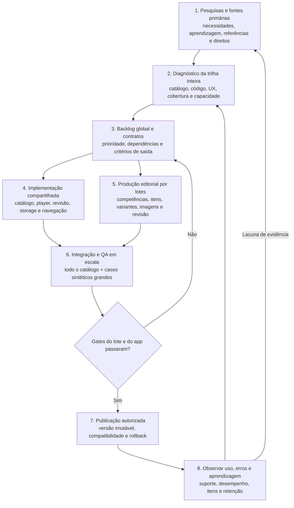
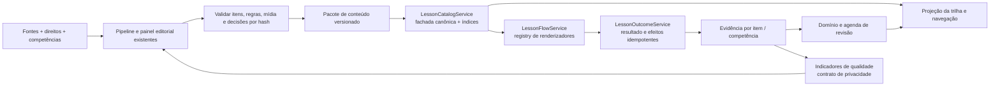

# Loop global de evolução e produção da trilha

**Data:** 2026-10-16, America/Bahia.  
**Autoria:** OpenAI Codex, família GPT-6; variante exata não exposta.  
**Direção [usuário]:** Anderson quer diagnóstico atual, melhorias globais de implementação e produção ampla/escalável; não quer dedicar o ciclo a aulas piloto. [ADR](../../adr/ADR-2026-10-16-evolucao-global-da-trilha-sem-pilotos.md).  
**Método:** [pesquisas existentes e complementares](../pesquisas/2026-10-16-producao-escalavel-e-qualidade-da-trilha.md) → [diagnóstico atual por código](../avaliacoes/2026-10-16-diagnostico-estrutural-global-da-trilha.md) → arquitetura e sequência de entrega.  
**Grau de evidência:** [código] para a base medida; [oficial]/[estudo] nas pesquisas; [inferido] para todo desenho, meta e pacote ainda não executado. Não é promessa de eficácia, prazo ou volume produzido.

## 1. Resultado a construir

[inferido] Uma trilha ampla precisa de um **sistema de conteúdo**: currículo organizado, banco de itens, motor reutilizável, histórico estável, produção por lotes e feedback que volta para o diagnóstico. O número de aulas é resultado desse sistema, não sua arquitetura.

[inferido] O aluno deve conseguir: entender o mapa; saber o próximo passo; estudar uma competência com variedade real de prática; receber explicação útil no erro; revisar itens que precisa recuperar; consultar o que concluiu; continuar offline; e receber conteúdo novo sem perder o histórico.

[código] Base medida: 18 lições legadas/38 perguntas, 12 atividades promovidas V2, quatro trilhas/30 resumos na composição local. O [inventário](../avaliacoes/2026-10-16-inventario-estrutural.json) não é uma nova medição da tela ou do binário publicado.

## 2. Fluxo de melhoria contínua

[inferido — arquitetura do processo] Este é um loop de produto/engenharia. A CLI Loop governa cada mudança; não foi criada uma automação recorrente.

| Etapa | Entrada → saída | Quem executa / critério para avançar |
| --- | --- | --- |
| Pesquisa | Dúvida específica → fonte, evidência, limite e implicação | Agente pesquisa; especialista decide conteúdo de risco. Reutilizar pesquisas existentes, sem refazer benchmark inteiro por sessão. |
| Diagnóstico | Snapshot versionado → mapa de lacunas e gargalos | Inventário automático + leitura do fluxo real. Distinguir “no repositório”, “alcançável” e “publicado”. |
| Priorização | Problemas → pacotes transversais | Ordenar por risco, alcance e dependências; contrato descreve o que muda em todas as lições afetadas. |
| Implementação | Spec → serviços/contratos compartilhados | Adaptadores e migrações preservam instalações existentes. Nada de componente especial por lição. |
| Produção | Competências/fontes → lote revisado | Banco de itens e ferramentas atuais; gabarito rastreável, mídia regular e feedback por erro. |
| Integração/QA | Código+lote → candidato verificável | Gates determinísticos no catálogo completo; prova nativa por classe de interação e estado, sem dispensar revisão semântica. |
| Publicação | Candidato aprovado → release identificável | Autorização de distribuição, artefatos, manifesto, compatibilidade e reversão definidos. |
| Observação | Uso/erros → nova prioridade | Dados com contrato de privacidade, versão do item e denominadores; não confundir conclusão/XP com domínio. |

## 3. Arquitetura para ampliar sem multiplicar motores

[inferido] Manter o app local-first e evoluir as fronteiras existentes:

[inferido] **Conteúdo canônico:** uma raiz editorial por artefato, já definida em `Conteúdo/`; app/API são saídas geradas quando aplicáveis. O pacote tem versão de schema e conteúdo, IDs estáveis, hash, relações, fontes, assets e aprovações. Não criar um segundo banco “oficial” só para a nova trilha.

[inferido] **Identidade e histórico:** separar ID estável de `revision`, variante e contexto. Mudança material na pergunta gera nova revisão e invalida aprovação correspondente. Tentativa registra versão respondida, ajuda e modo de interação. Alterar título não apaga progresso; mudança de competência ou critério exige política de equivalência explícita. ID histórico de tórax/abdome pode continuar como alias interno.

[inferido] **Player:** usar o registry existente para múltipla escolha, seleção em imagem, comparação, associação e ordenação onde já houver contrato/renderizador; expandir só o que faltar. O compilador monta sessões a partir de itens aprovados, com seleção reprodutível e retomada. Feedback acompanha a resposta e a imagem relevante. Repetição não gera efeitos duplicados.

[inferido] **Revisão:** agenda por item/conceito é distinta de domínio por competência. Introduzir uma interface de agendador e uma migração conservadora do SM-2; comparar o modelo de competência já existente com FSRS por histórico e simulação. Recomendo habilitar primeiro a cadeia de leitura/seleção/evidência e controlar a carga; escolha do algoritmo definitivo não bloqueia corrigir o catálogo e produzir conteúdo.

[inferido] **Mídia:** evoluir `ProductionBatch` para um contrato versionado que aceite referências aprovadas; incluir hashes de assets/transformações no material aprovado. O contrato atual proíbe mídia. Pacote só fica disponível offline quando seus arquivos obrigatórios estão presentes e íntegros; metadado recebido não é disponibilidade. Não depender da API pública atual para o núcleo de estudo.

## 4. Organização da trilha inteira

[inferido] Hierarquia sugerida: **currículo → área/trilha → unidade temática → lição → item**. Os arcos V3 existentes são a referência de áreas; não precisam virar outro sistema de progresso. Pré-requisitos formam grafo validado e a interface apresenta uma sequência clara dentro dele.

| Área de organização proposta | Famílias de competências a mapear, com revisão editorial |
| --- | --- |
| Fundamentos e segurança radiológica | Matéria/energia, formação da imagem, proteção, profissão e fundamentos comuns |
| Radiografia | Anatomia de referência, posicionamento, projeções e critérios técnicos de imagem |
| Mamografia | Fundamentos da modalidade, posicionamento e qualidade técnica |
| Tomografia computadorizada | Aquisição, reconstrução, orientação espacial, qualidade e segurança |
| Ressonância magnética | Formação do sinal, famílias de sequência, artefatos e segurança |
| Medicina nuclear | Formação de imagem, instrumentação e fundamentos de segurança |
| Radioterapia | Fundamentos, processo técnico e segurança |
| Outras especializações | Estrutura reservada no currículo; só entra na trilha estudável quando houver conteúdo aprovado |

[inferido] Esta é uma proposta de organização, não conteúdo clínico aprovado nem liberação das áreas. Para cada unidade, definir objetivo observável, pré-requisitos, erros comuns, prática, avaliação, revisão e fontes antes de produzir itens. Qualidade técnica da imagem vira competência transversal, não um piloto separado.

[inferido] Na interface: mostrar área atual e próxima ação; agrupar o percurso por unidades; recolher concluídas com acesso rápido; apresentar bloqueios com motivo; oferecer revisão sem ocupar metade da linha de nós; preservar posição/retomada e caminho de consulta. Não mostrar centenas de nós expandidos. A FlatList já existe: o trabalho inclui reduzir projeções repetidas, indexar o catálogo por versão e medir o custo, não apenas trocar o componente de lista.

## 5. Fábrica editorial: do conhecimento ao lote

[inferido] Fluxo de cada lote:

1. Selecionar competências pela matriz de cobertura, não pelo PDF disponível da vez.
2. Vincular fontes com direito de uso e versão; registrar fatos/afirmações sustentados e responsável.
3. Criar ou reutilizar famílias de item: reconhecimento, aplicação, comparação e recuperação independente.
4. Gerar candidatos e variantes dentro dos limites do modelo. IA auxilia redação; código verifica invariantes e gabarito calculável; gabarito factual/de imagem exige referência revisada.
5. Validar forma e semântica estrutural em todos os candidatos: IDs, dependências, uma resposta válida, fontes existentes, feedback, media, pistas, duplicação, acessibilidade e diversidade.
6. Revisar semântica/risco e corrigir o lote no painel. Manter os seis gates existentes; qualquer política nova de amostragem ou delegação precisa ser explicitamente definida.
7. Compilar pacote candidato e verificar resoluções no mesmo caminho do app.
8. Executar QA e produzir relatório de cobertura, rejeições, custo e capacidade.
9. Publicar a versão autorizada e registrar problemas observados por versão do item.

[inferido] **Aprovação por modelo não é cheque em branco:** variantes determinísticas herdam só a validade da regra dentro do domínio testado; afirmação clínica, imagem ou contexto novo não herda automaticamente revisão semântica. O ganho de escala vem de reuso de estrutura, gates automáticos e tratamento de exceções, mantendo rastreabilidade individual.

[inferido] Medidas distintas por lote: competências cobertas, itens base, variantes, casos independentes de imagem, taxa de aprovação, retrabalho e tempo de revisão. Evitar contar dez paráfrases como dez competências novas. O painel deve priorizar pendências e explicar a reprovação, permitindo revisão em lote e rastreio até a fonte.

## 6. Pacotes de implementação global

Todos são [inferido — proposta de execução]. O diagnóstico/instrumento deste documento está entregue; os pacotes abaixo **ainda não foram implementados**.

| Pacote | Escopo e pontos principais do código | Dependência / prova de saída |
| --- | --- | --- |
| **G0 — Inventário completo e cobertura** | Ampliar `trilha-structural-inventory.cjs` com payloads alcançáveis, tipos de interação, fontes, competências, mídia, stores e migrações; exportar lacunas por área | Agora. Relatório reprodutível do catálogo inteiro, sem confundir resumos com atividades resolvidas; nenhum ID órfão/duplicado não explicado. |
| **G1 — Catálogo/motor para múltiplos lotes** | `ProductionCurriculumCatalog`, `ProductionBatch`, `LessonCatalogService`, `JourneyDefinitionService`, `LessonFlowService`; metadados por lote, IDs globais, índices por versão, montagem compartilhada | G0. Dois lotes independentes com nomes/IDs corretos e fixtures de escala; todos os payloads resolvidos, progresso preservado. P1/FILA 50 corrige o caminho legado no mesmo programa, sem virar aula isolada. |
| **G2 — Mapa curricular e navegação global** | Currículo/competências, projeção da jornada, `JourneyHomeScreen`, `JourneyTrail`, resolver do próximo nó | G0, contrato G1. Matriz objetivo/prática/avaliação/revisão, grafo sem ciclos e unidades organizadas; zero destino impossível e zero liberação de conteúdo ausente. |
| **G3 — Produção editorial em lotes** | `scripts/content`, contratos de conteúdo e painel editorial; autoria e validação por família, dependências e fonte | G0; pode preparar conteúdo enquanto G1 evolui. Lote compilado pelo mesmo pipeline do app, relatório de rendimento/retrabalho; seis gates íntegros e aprovação invalidada após alteração material. |
| **G4 — Evidência e revisão por item** | `LearningEvidenceRepository`, `LearningAttemptRecorder`, SM-2, `CompetencyReviewService`, resolvers, revisão e resultados | G1/identidades G2. Tentativa idempotente, primeira resposta/ajuda diferenciadas, fila vencida por item, migração retomável e sem avalanche; falha de persistência não concede domínio indevido. |
| **G5 — Imagens e pacote offline** | Manifesto de mídia, contrato versionado do lote, resolver de asset e renderizadores; prioridade transversal de qualidade técnica | G1 + acervo com direitos/revisão. Geometria correta em proporções diferentes, alvos úteis, enquadramento válido e conteúdo íntegro após reinício sem rede; retirada de asset/licença rastreável. |
| **G6 — QA de robustez e capacidade** | Contratos, CI, Maestro, instrumentação iOS/Android, fixtures sintéticas e falhas injetadas | Inicia em G1, consolida G2–G5. Matriz da seção 7 executada; catálogo real validado integralmente, caminhos nativos por classe/estado e relatório de desempenho. |
| **G7 — Distribuição e compatibilidade** | Empacotamento local; pacote remoto só após contrato de entrega, origem, integridade e reversão; política de migração/rollback | G6 + autorização de release. Versão identificável no app, compatibilidade de schema, falha de atualização preserva versão utilizável e histórico. |
| **G8 — Qualidade contínua** | Contrato de métricas local, adaptador remoto após decisão de privacidade/provedor, dashboards de conteúdo e erros | Contrato começa em G0; telemetria remota depende da FILA 43. Dados por versão/denominador alimentam backlog; nenhuma taxa sem tamanho de amostra e nenhuma eficácia inferida de XP. |

[inferido] Ordem prática: **G0 → G1 + P1/E1 existentes → G2/G3 → G4/G5 → G6/G7 → G8 contínuo**. Pesquisa, organização curricular e preparação editorial podem avançar em paralelo lógico, mas escritores do mesmo projeto continuam serializados pelo Loop. Não é necessário esperar analytics remoto, lote de imagem ou escolha do FSRS para melhorar o motor global.

## 7. Qualidade e capacidade em catálogo grande

[inferido — critérios propostos] Executar no catálogo real inteiro e em perfis sintéticos de **100 unidades, 1.000 lições e 10.000 itens**. Esses números são cenários de teste; não conteúdo pronto nem meta de publicação aprovada.

| Dimensão | Verificação concreta |
| --- | --- |
| Estrutura | Unicidade global de IDs, aliases, resolução de payload/asset/fonte; grafo sem ciclos; todo nó desbloqueável tem caminho válido; ausência de conteúdo impede publicação do destino. |
| Aprendizagem | Toda competência tem objetivo e evidência de prática/avaliação; registrar exposição, ajuda e recuperação independente de forma distinta; não conceder domínio por mera conclusão. |
| Itens | Triagem de pistas/distratores, correção inequívoca, feedback por erro, variantes dentro de limites e casos de avaliação separados de treino. Score de LLM não é veredito único. |
| Histórico | Migração idempotente e interrompível, repetição sem XP duplicado, retomada, falha de escrita, schema futuro e backup/restore com inventário de stores efetivamente cobertos. |
| Offline/atualização | Primeira abertura e reinício sem rede; falta/hash incorreto de asset; atualização parcial; versão incompatível; rollback de conteúdo sem apagar conquistas/tentativas. |
| UI/acessibilidade | Texto grande, leitor de tela, movimento reduzido, área de toque, alvos próximos, orientação, estados vazio/concluído/bloqueado e acesso ao próximo nó longe do início. |
| Desempenho | Mesma build/configuração/aparelho; medir p50/p95 de abertura, troca de área, resolução do próximo nó, consulta e persistência; pico de memória, tamanho em disco e custo de projeção. |
| Privacidade | Schema fechado dos eventos, minimização, limites de retenção e payloads sem imagem clínica/dado pessoal indevido; envio remoto só com contrato aprovado. |

[inferido] Definir orçamento absoluto a partir da baseline nos aparelhos alvo. Até lá, usar como alerta proposto regressão de p95 acima de 10% no mesmo cenário e crescimento sem limite; não declarar performance aprovada usando apenas Jest ou catálogo pequeno. Preservar os gates de performance já existentes onde forem aplicáveis.

[inferido] Guards precisam ser vistas falhando com defeitos específicos: segundo lote reutilizando ID de conquista, ciclo de pré-requisito, asset fora do pacote, repetição que duplica XP e versão futura sobrescrita. Uma suíte verde sem esses comportamentos não comprova escalabilidade.

## 8. Operação do Loop e decisões

[inferido] Cada pacote futuro é uma entrega coesa: consultar STATUS/FILA e evidência → medir baseline → declarar escopo → checkpoint → editar/testes focados → revisão do diff → uma validação final configurada → concluir passo → memória se durável → fechar run. Não abrir um run por lição e não segurar um run de meses para toda a expansão.

[código] Comandos existentes: `node scripts/loop/abrir.mjs "<objetivo>" <arquivos...>`, `loop validate`, `loop step finish`, `loop memory write` quando houver decisão/aprendizado e `loop run close`, conferindo cada envelope. Loop usa Node 24; inventário/app/API usam Node 20. Não executar validação integral durante E2E.

[usuário] **Decidido:** trabalhar a trilha inteira e escalar produção, sem aulas piloto como condição de avanço. **Ainda não decidido:** investimento/equipe/cadência, desenho curricular final e fornecedor/contrato de analytics. [inferido] Essas decisões não precisam ser todas resolvidas antes de G0/G1. Mudança de regra de produto, risco editorial ou distribuição volta ao dono; escolhas técnicas reversíveis dentro do contrato não viram pedidos de permissão por arquivo.

## 9. Referências e relação com o plano anterior

- [Diagnóstico atual e fontes de código](../avaliacoes/2026-10-16-diagnostico-estrutural-global-da-trilha.md).
- [Pesquisa de produção/qualidade e fontes oficiais](../pesquisas/2026-10-16-producao-escalavel-e-qualidade-da-trilha.md), acessadas em 2026-10-16.
- [Plano anterior de três horizontes](2026-10-16-plano-de-melhoria-da-trilha.md): reaproveitar P1, organização, revisão, medição e mídia, reinterpretados como capacidades globais.
- [Plano detalhado P1](2026-10-16-licao-legada-honesta.md): não foi implementado nesta entrega.
- [Pipeline existente](../../CONTENT_PIPELINE.md), [arquitetura existente](../../ARCHITECTURE_STATE.md) e [ADR da direção global](../../adr/ADR-2026-10-16-evolucao-global-da-trilha-sem-pilotos.md).

[usuário] A proposta anterior centrada em piloto fica superada como direção desta frente. [inferido] A pesquisa visual continua útil; as restrições técnicas e editoriais seguem válidas. O plano global é uma sequência de implementação verificável, sem prometer que a trilha já foi ampliada.
